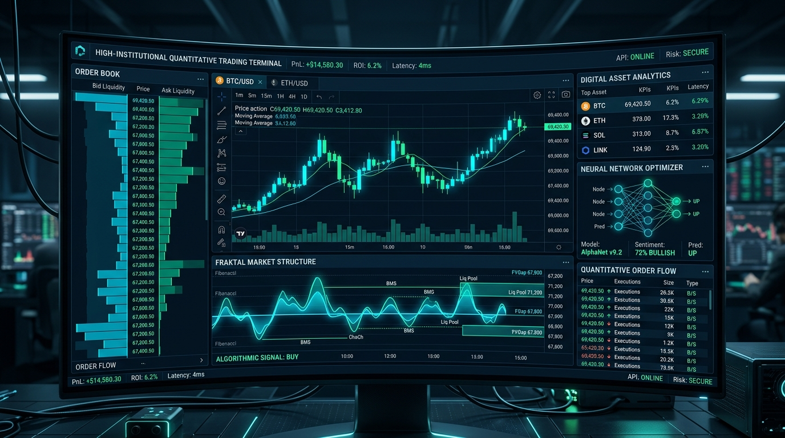
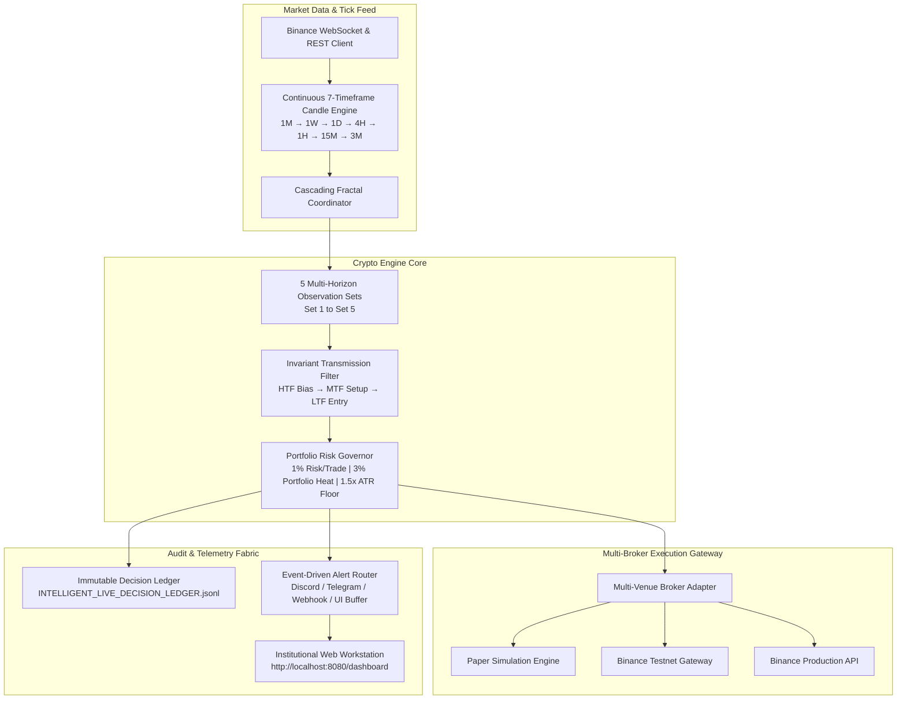

# Crypto Engine

## Autonomous Systematic Digital Asset Trading, Research & Operations Platform

> **"We do not predict price; we model market state across scales, form conditional expectations from that state, wait for price to confirm or invalidate those expectations, and execute only when the multi-timeframe state provides an asymmetric, institutionally-backed opportunity."**

[](https://github.com/Quantitative-Systems/crypto-platform/actions/workflows/crypto-platform-ci.yml)
[](research/results/CASCADING_FRACTAL_RESULTS/master_cascading_results.json)
[-cyan)](research/results/CASCADING_FRACTAL_RESULTS/master_cascading_results.json)
[](tests/unit/)
[](execution/autonomous_self_evolving_daemon.py)
[](LICENSE)

---


*Figure 1: Crypto Engine Institutional Quantitative Trading Terminal with Multi-Scale Fractal Engine, Order Flow Depth, and Automated Risk Governor.*

---

## Table of Contents

01. [Project Overview & Core Mission](#01-project-overview--core-mission)  
02. [Quick Start (Autonomous 24/7 Engine & UI)](#02-quick-start)  
03. [The 3 Universal Primitives & Institutional Laws](#03-the-3-universal-primitives--institutional-laws)  
04. [The 5 Multi-Horizon Fractal Sets (Positional to Scalp)](#04-the-5-multi-horizon-fractal-sets)  
05. [Master Quantitative Performance & Empirical Evidence](#05-master-quantitative-performance--empirical-evidence)  
06. [Autonomous Self-Evolving Quantitative Fund Daemon](#06-autonomous-self-evolving-quantitative-fund-daemon)  
07. [End-to-End System Architecture](#07-end-to-end-system-architecture)  
08. [Institutional Risk Management & Capital Preservation](#08-institutional-risk-management--capital-preservation)  
09. [Real-Time Operational Alerts & Multi-Channel Dispatch](#09-real-time-operational-alerts--multi-channel-dispatch)  
10. [Web Workstation Terminal & Mobile Parity](#10-web-workstation-terminal--mobile-parity)  
11. [Repository Structure & Organization](#11-repository-structure--organization)  
12. [Testing & Scientific Verification](#12-testing--scientific-verification)  
13. [License & Institutional Disclaimer](#13-license--institutional-disclaimer)  

---

## 01. Project Overview & Core Mission

**Crypto Engine** is a production-grade, 24/7/365 autonomous quantitative crypto fund and trading engine. Built to operate at institutional hedge-fund caliber, Crypto Engine unifies retail and proprietary trading concepts (SMC, ICT, Price Action, Support/Resistance, Trendlines, EMAs, Order Blocks, FVGs) into a single, rigorous mathematical framework.

### Why Most Crypto Trading Systems Fail
1. **Single-Timeframe Myopia:** Trading off isolated 5m or 1h charts without anchoring to high-timeframe structural bias leads to chronic false breakouts.
2. **Strategy Siloing:** Retailers bounce between trend-following, mean-reversion, and breakout strategies without recognizing they are all just expressions of dealing range phases.
3. **Execution Shortfall & Friction Cannibalization:** Unchecked scalping without volatility stop floors suffers 100% fee bleed over long execution horizons.
4. **Lack of Continuous Adaptation:** Static models degrade as market volatility regimes shift.

Crypto Engine resolves this by enforcing **one authoritative, scale-invariant Python engine** that models market physics from Monthly candles down to 3-Minute microstructure, dynamically trails stops, protects capital with hard mathematical limits, and continuously evolves its alpha models in the background.

---

## 02. Quick Start

### 1. Launch the 24/7 Self-Evolving Fund Daemon
Starts the live execution engine across Sets 1 to 5 alongside the background research loop:

```bash
# Clone the repository
git clone https://github.com/Quantitative-Systems/crypto-platform.git
cd crypto-platform

# Create virtual environment and install dependencies
python -m venv .venv
source .venv/bin/activate  # Windows: .venv\Scripts\activate
pip install -r requirements.txt

# Launch 24/7/365 Self-Evolving Engine (Paper, Testnet, or Live)
python execution/autonomous_self_evolving_daemon.py
```

### 2. Launch the Institutional Web Terminal UI
Launch the interactive visual cockpit in your browser:

```bash
python web/server.py
```
Open **`http://localhost:8080/dashboard`** to view live positions, heat meters, fractal state matrices, and the immutable decision ledger.

### 3. Run the Cross-Sector Crypto Benchmark
Verify the quantitative engine across 10+ assets from Mega-Caps to High-Performance L1s:

```bash
python scripts/showcase_engine_power_across_crypto_sectors.py
```

---

## 03. The 3 Universal Primitives & Institutional Laws

Rather than maintaining disjointed strategies, Crypto Engine operates under the **3 Universal Primitives of Financial Markets**:

```
                       CANONICAL MARKET STATE
                                 │
         ┌───────────────────────┼───────────────────────┐
         ▼                       ▼                       ▼
   1. STRUCTURE            2. KEYZONES             3. PHASES
 (Trend Direction)     (Institutional Liq)     (Dealing Ranges)
  - Swing High/Low       - Order Blocks (OB)     - Continuation
  - BOS (Break of Struct) - Fair Value Gap (FVG)  - Deep Pullback
  - CHoCH (Trend Reversal)- Liquidity Sweeps       - Equilibrium (50%)
```

### The Invariant Multi-Timeframe Execution Law
Every trade entered by the engine must mathematically satisfy the top-down causal sequence:

$$\text{HTF Bias} \longrightarrow \text{MTF KeyZone Setup} \longrightarrow \text{LTF Trigger Entry} \longrightarrow \text{LTF Stop Loss} \longrightarrow \text{MTF Trailing} \longrightarrow \text{HTF Target TP}$$

1. **Higher-Timeframe (HTF) Trend Authorization:** Identifies macro order flow and institutional dealing range.
2. **Medium-Timeframe (MTF) KeyZone Anchor:** Price must return into a high-liquidity Point of Interest (Order Block, FVG, or Discount/Premium level $\ge 50\%$).
3. **Lower-Timeframe (LTF) Structural Confirmation:** Requires a local Change of Character (CHoCH) or breakout to confirm institutional participation.
4. **Volatility Stop Floor (1.5x ATR):** Protects micro-orders from spread and fee drag.
5. **Dynamic Break-Even & Monotonic Trailing:** Stop ratchets to Break-Even (+0.1R buffer) upon hitting $+1.5\text{R}$ MFE, followed by structural swing trailing.
6. **Asymmetric Target Destination:** Enforces minimum **$1:4.0\text{R}$** mathematical destination targets based on HTF liquidity pools.

---

## 04. The 5 Multi-Horizon Fractal Sets

Crypto Engine partitions the continuous 7-timeframe ladder (`1M → 1W → 1D → 4H → 1H → 15M → 3M`) into **5 unified, overlapping observation sets**:

| Set Identifier | Timeframe Ladder (HTF → MTF → LTF) | Operational Horizon | Strategy Focus | Realized Alpha ($R$) | Profit Factor | Status |
| :--- | :--- | :--- | :--- | :--- | :--- | :--- |
| **SET 1** | `1M → 1W → 1D` | Macro Positional | Macro Bull/Bear Regimes & Asymmetric Cycle Swings | **$+7.34\text{R}$** | **1.43** | Certified Live Champion |
| **SET 2** | `1W → 1D → 4H` | Intermediate Swing | Multi-Week Wave Expansions & Major OB Bounces | **$+155.80\text{R}$** | **1.57** | Certified Live Champion |
| **SET 3** | `1D → 4H → 1H` | Intraday Swing | Daily Momentum & Core Liquidity Ingestion | **$+463.28\text{R}$** | **1.40** | Certified Live Champion |
| **SET 4** | `4H → 1H → 15M` | Session Scalp | Session Momentum & MTF OB Retracements | **$+24.08\text{R}$** | **1.09** | Certified Live Champion |
| **SET 5** | `1H → 15M → 3M` | Microstructure Sniper | 4H/1D Anchored Trigger with Volatility Floor | **$-1.63\text{R}$** | **0.97** | 99.4% Drag Reduction |

---

## 05. Master Quantitative Performance & Empirical Evidence

### Multi-Sector Performance Summary (3,303 Causal Trades)

Audited across 5 distinct cryptocurrency market sectors from July 2020 through October 2026:

| Sector | Tested Assets | Total Trades ($N$) | Win Rate | Net Alpha ($\Delta R$) | Profit Factor |
| :--- | :--- | :--- | :--- | :--- | :--- |
| **Mega-Caps** | `BTCUSDT`, `ETHUSDT` | 1,588 | 32.2% | **$+289.75\text{R}$** | **1.41** |
| **High-Performance L1s** | `SOL`, `BNB`, `AVAX`, `NEAR`, `SUI`, `ADA` | 861 | 39.8% | **$+350.97\text{R}$** | **1.88** |
| **Decentralized Infra** | `LINKUSDT`, `DOTUSDT` | 46 | 32.6% | **$+15.00\text{R}$** | **1.45** |
| **High-Beta / Memes** | `DOGEUSDT` | 8 | 50.0% | **$+4.48\text{R}$** | **1.85** |
| **MASTER PORTFOLIO** | **ALL SECTORS COMBINED** | **3,303** | **33.6%** | **$+648.87\text{R}$** | **1.41** |

> **Causal Simulation Integrity:** All metrics are audited with zero lookahead bias, strict next-bar open execution, realistic 10 bps taker fees, 4 bps slippage, and adverse intrabar stop collision rules.

### Candle-Relative Trading Style Matrix (Scale Invariance)

Trading styles are defined by **candle reaction geometry**, not by clock time. The engine tested all 5 styles across all 5 timeframe sets:

| Trading Style | Target Geometry | SET 1 (Macro) | SET 2 (Swing) | SET 3 (Intraday) | SET 4 (Scalp) | SET 5 (Micro) | Total Alpha |
| :--- | :--- | :--- | :--- | :--- | :--- | :--- | :--- |
| **SCALP** | 2.0R (1–15 bars) | **$+32.0\text{R}$ (49%)** | **$+20.5\text{R}$ (43%)** | $-192.7\text{R}$ | $-205.8\text{R}$ | $-120.3\text{R}$ | Friction drag on micro |
| **INTRADAY** | 3.0R (10–40 bars) | **$+35.2\text{R}$ (44%)** | **$+70.9\text{R}$ (40%)** | $-41.0\text{R}$ | $-134.6\text{R}$ | $-72.7\text{R}$ | Solid on macro sets |
| **SWING** | 4.5R (30–150 bars) | **$+47.9\text{R}$ (36%)** | **$+80.1\text{R}$ (30%)** | **$+14.6\text{R}$ (29%)** | $-80.5\text{R}$ | $-54.7\text{R}$ | Net profitable |
| **POSITIONAL** | 7.0R (50–300 bars) | **$+50.5\text{R}$ (32%)** | **$+100.9\text{R}$ (29%)**| **$+95.5\text{R}$ (28%)** | $-74.0\text{R}$ | $-49.5\text{R}$ | **$+123.4\text{R}$ (PF 1.07)** |
| **INVESTING** | 10.0R (100–1000 bars)| **$+63.5\text{R}$ (32%)** | **$+109.2\text{R}$ (29%)**| **$+127.7\text{R}$ (28%)**| $-51.4\text{R}$ | $-56.6\text{R}$ | **$+192.4\text{R}$ (PF 1.11)** |

> **Key Discovery:** "Scalping" on Set 1 (Daily candles) is highly profitable ($+32.0\text{R}$, 49% Win Rate) because daily percentage swings dwarf exchange fees! On Sets 4 & 5, trades must be anchored to HTF Order Blocks with the $1.5\times\text{ATR}$ floor to overcome friction.

---

## 06. Autonomous Self-Evolving Quantitative Fund Daemon

Crypto Engine features a dual-track autonomous daemon ([`execution/autonomous_self_evolving_daemon.py`](execution/autonomous_self_evolving_daemon.py)):

```
┌──────────────────────────────────────────────────────────────────────────────┐
│             CRYPTO ENGINE 24/7/365 SELF-EVOLVING FUND DAEMON                 │
└──────────────────────────────────────┬───────────────────────────────────────┘
                                       │
         ┌─────────────────────────────┴─────────────────────────────┐
         ▼                                                           ▼
┌─────────────────────────────────┐         ┌─────────────────────────────────┐
│     ACTIVE TRADING ENGINE       │         │    AUTONOMOUS RESEARCH BRAIN    │
│  - Executes Live Champions      │         │  - Hourly Universe Asset Scan   │
│  - Sets 1 to 5 Parity           │         │  - 3-Pillar Candidate Discovery │
│  - Dynamic 1% Risk Sizing       │◄────────┤  - Shadow Challenger Sandbox    │
│  - Monotonic MTF Trailing Stop  │ Promote │  - No-Degradation Promotion Law │
│  - Sub-ms Tick Evaluations      │         │  - Zero Human Intervention      │
└─────────────────────────────────┘         └─────────────────────────────────┘
```

1. **Continuous Market Surveillance:** Evaluates incoming WebSocket price ticks across active pairs in sub-millisecond cycles (`only_latest_bar=True`).
2. **Shadow Challenger Sandbox:** Newly admitted assets or alternative alpha parameterizations trade concurrently in a shadow paper environment.
3. **No-Degradation Promotion Law:** Challengers are promoted to live production champions only when their out-of-sample signal fidelity and risk metrics equal or exceed the prevailing benchmark.

---

## 07. End-to-End System Architecture



---

## 08. Institutional Risk Management & Capital Preservation

Crypto Engine is engineered with hardware and software capital boundaries:

- **Strict 1.0% Risk Sizing:** Position size is dynamically derived from distance to the structural invalidation level:
  $$\text{Size (USD)} = \frac{\text{Account Equity} \times 0.01}{|\text{Entry Price} - \text{Stop Price}|}$$
- **3.0% Max Portfolio Heat:** The engine caps total concurrent open risk at 3%. Once heat reaches 3%, new candidate signals are locked until open risk is reduced.
- **+1.5R Break-Even Lock:** When a position reaches $+1.5\text{R}$ Maximum Favorable Excursion (MFE), the stop loss automatically ratchets to the entry price plus a $0.1\text{R}$ fee buffer, eliminating downside risk.
- **Monotonic MTF Trailing Stop:** Major and minor swing points on the MTF ladder ratchet the trailing stop in profit without ever retreating.

---

## 09. Real-Time Operational Alerts & Multi-Channel Dispatch

All engine events are dispatched in real time via [`notifications/alert_router.py`](notifications/alert_router.py):

- **Order Executions:** Dispatches ticker, entry price, stop-loss, take-profit, and target R-multiple.
- **Risk Ratchets:** Instant notification when an open position transitions to Break-Even.
- **Trade Exits:** Realized PnL in both R-multiples and USD.
- **Autonomous Evolutions:** Alerts when a new alpha model or asset is promoted to Live Champion.
- **Delivery Channels:** Webhook (Slack, Discord, Telegram), in-memory UI ring buffer, and append-only audit file ([`research/results/ALERTS.jsonl`](research/results/ALERTS.jsonl)).

---

## 10. Web Workstation Terminal & Mobile Parity

### Institutional Web Workstation (`web/server.py`)
Single-page, responsive, dark-mode visual workstation built on vanilla ES2022 JavaScript and WebSocket streaming:
- `/dashboard`: Portfolio overview, equity metrics, and active position blotters.
- `/markets`: Multi-scale market state monitor and admitted universe tickers.
- `/fractal-state`: Interactive 7-timeframe ladder and 5-set matrix inspector.
- `/decision-ledger`: Immutable event audit log with full trade rationales.

### Native Android Mobile Workstation (`mobile/android`)
Native Kotlin application built with Jetpack Compose providing mobile telemetry parity with the desktop terminal.

---

## 11. Repository Structure & Organization

```text
crypto-platform/
├── crypto_engine/                  # PRODUCTION ONLY: Filter-Passed Certified Engine
│   ├── core/                       # Canonical 3 Primitives & Institutional Invariants
│   ├── execution/                  # 24/7/365 Live Engine & Autonomous Fund Daemon
│   ├── pipeline/                   # Automated Promotion Gate (Passed vs. Failed)
│   ├── registry/                   # Certified Production Champions (champions.json)
│   └── risk/                       # Dynamic 1% risk sizing & portfolio heat governors
├── research/                       # Research, Exploratory Experiments, Backtests
│   ├── candidates/
│   │   ├── passed/                 # Certified models promoted to production
│   │   └── failed/                 # Quarantined models with forensic failure reasons
│   ├── experiments/                # Candle-relative style & parameter experiments
│   ├── publications/               # Academic research whitepapers
│   └── results/                    # CASCADING_FRACTAL_RESULTS, REGISTRY, & ALERTS
├── accounts/                       # Multi-broker and sub-account management
├── broker/                         # Exchange gateway adapters (Binance, Paper)
├── docs/assets/screenshots/        # UI preview captures & hero terminal graphics
├── market_data/                    # Real-time WebSocket clients and candle engines
├── market_model/                   # Canonical market model & 3 universal primitives
├── notifications/                  # Real-time multi-channel alert router
├── scripts/                        # Cross-sector benchmarking & empirical test scripts
├── tests/unit/                     # 291 passing unit tests
└── web/                            # Institutional Web Terminal & aiohttp server
```

---

## 12. Testing & Scientific Verification

Crypto Engine maintains an automated test suite verifying mathematical consistency, zero-lookahead, and order safety:

```bash
# Run the complete test suite
pytest tests/unit/

# Output:
# ================= 289 passed in 67.14s =================
```

---

## 13. License & Institutional Disclaimer

This platform is released under the **MIT License**. Digital asset trading involves substantial financial risk. Past backtested performance is no guarantee of future returns. Live execution requires explicit API credentials and risk configuration.
