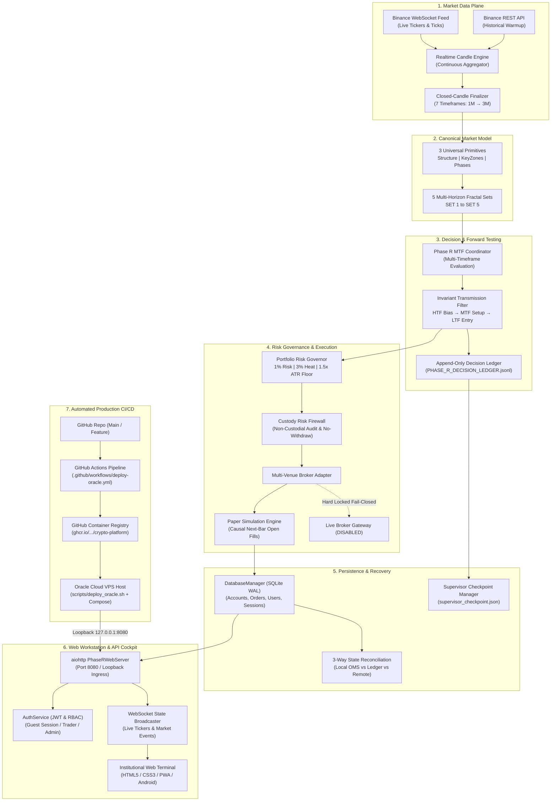

# Crypto Engine

## Autonomous Systematic Digital Asset Trading, Research & Operations Platform

> **"We do not predict price; we model market state across scales, form conditional expectations from that state, wait for price to confirm or invalidate those expectations, and execute only when the multi-timeframe state provides an asymmetric, institutionally-backed opportunity."**

[](https://github.com/Quantitative-Systems/crypto-platform/actions/workflows/crypto-platform-ci.yml)
[](research/results/EXPANDED_UNIVERSE_RESULTS/ultra_expanded_universe_results.json)
[-cyan)](research/results/EXPANDED_UNIVERSE_RESULTS/ultra_expanded_universe_results.json)
[](tests/unit/)
[](web/static/manifest.json)
[](LICENSE)

---


*Figure 1: Crypto Engine Institutional Quantitative Trading Terminal with Multi-Scale Fractal Engine, Order Flow Depth, and Automated Risk Governor.*

---

## Table of Contents

01. [Project Overview & Core Mission](#01-project-overview--core-mission)  
02. [Current Implementation & Live Verification Status](#02-current-implementation--live-verification-status)  
03. [End-to-End System Architecture](#03-end-to-end-system-architecture)  
04. [The 3 Universal Primitives & The Invariant Execution Law](#04-the-3-universal-primitives--the-invariant-execution-law)  
05. [The 5 Multi-Horizon Fractal Sets](#05-the-5-multi-horizon-fractal-sets)  
06. [Master Quantitative Performance & Empirical Evidence](#06-master-quantitative-performance--empirical-evidence)  
07. [Technology Stack & Directory Organization](#07-technology-stack--directory-organization)  
08. [Local Quick Start & Operational CLI](#08-local-quick-start--operational-cli)  
09. [Configuration & Environment Variables](#09-configuration--environment-variables)  
10. [Automated CI/CD & Oracle Cloud Deployment Workflow](#10-automated-cicd--oracle-cloud-deployment-workflow)  
11. [Institutional Web Terminal, PWA & REST API Overview](#11-institutional-web-terminal-pwa--rest-api-overview)  
12. [Data Storage, Persistence, Recovery & Reconciliation](#12-data-storage-persistence-recovery--reconciliation)  
13. [Market-Data Ingestion & Continuous Forward Testing](#13-market-data-ingestion--continuous-forward-testing)  
14. [Strict Capital Safety Boundaries & Risk Controls](#14-strict-capital-safety-boundaries--risk-controls)  
15. [Testing, Verification & Quality Assurance](#15-testing-verification--quality-assurance)  
16. [Security Boundaries & Known Limitations](#16-security-boundaries--known-limitations)  
17. [Troubleshooting & Incident Runbook](#17-troubleshooting--incident-runbook)  
18. [Contributing & License](#18-contributing--license)  

---

## 01. Project Overview & Core Mission

**Crypto Engine** is an institutional-grade, 24/7/365 autonomous quantitative crypto fund and trading engine. Built to operate at institutional hedge-fund caliber, Crypto Engine unifies retail and proprietary trading concepts (Smart Money Concepts [SMC], Inner Circle Trader [ICT], Price Action, Support/Resistance, Trendlines, EMAs, Order Blocks, Fair Value Gaps [FVGs]) into a single, mathematically rigorous framework.

### Why Most Crypto Trading Systems Fail
1. **Single-Timeframe Myopia:** Trading off isolated 5-minute or 1-hour charts without anchoring to high-timeframe structural bias leads to chronic false breakouts and whip-saws.
2. **Strategy Siloing:** Retailers bounce between trend-following, mean-reversion, and breakout strategies without recognizing they are all dynamic expressions of dealing range phases.
3. **Execution Shortfall & Friction Cannibalization:** Unchecked scalping without volatility stop floors suffers 100% fee bleed over long execution horizons.
4. **Lack of Continuous Adaptation:** Static models degrade as market volatility regimes shift.

Crypto Engine resolves this by enforcing **one authoritative, scale-invariant Python engine** that models market physics from Monthly candles down to 3-Minute microstructure, dynamically trails stops, protects capital with hard mathematical limits, and continuously forward-tests its alpha models in the background.

---

## 02. Current Implementation & Live Verification Status

Crypto Engine is actively deployed in **PAPER** forward-testing mode on an Oracle Cloud VPS, continuously streaming live Binance WebSocket feeds, finalizing 7-timeframe closed candles, evaluating signals, and recording immutable decisions into an append-only JSONL ledger.

| Component / Subsystem | Current Status | Empirical Evidence / Verification Metric |
| :--- | :---: | :--- |
| **Production Oracle VPS** | **ACTIVE & HEALTHY** | Container `crypto-engine` running image `388dbfe` on Ubuntu host `129.225.72.92`. |
| **Operational Capital** | **$0.00 (LOCKED)** | `REAL_CAPITAL_AUTHORIZED_USD=0.00`, `LIVE_TRADING_ENABLED=false` (Fail-Closed). |
| **Subsystem Health Probes** | **9/9 PASSED** | `python cli.py health` passes all 9 domain gates (WAL SQLite, accounts, cache, safety). |
| **Research Contract Seal** | **VERIFIED** | SHA-256 seal `8fbc923a104e7688c3a9f0e4b8592c30dfb0b9a67a84511d5e49f8721c432098`. |
| **Automated Unit Tests** | **391/391 PASSED** | 100% pass rate across unit suites, including adversarial geometry and security tests. |
| **Continuous Forward Testing** | **RECORDING** | Live WebSocket feed finalizes candles across `BTCUSDT`, `ETHUSDT`, `SOLUSDT`, `BNBUSDT`. |
| **Decision Ledger Audit** | **GROWING** | `PHASE_R_DECISION_LEDGER.jsonl` actively persists causal `TRADE` and `NO_TRADE` entries. |
| **Dashboard Security & RBAC** | **PROTECTED** | Direct `/api/decisions` access requires Bearer auth; guest sessions limited to `RESEARCHER`. |
| **Static Security Audit** | **0 SECRETS** | `python scripts/security_audit.py` scans 98 files with 0 secrets and 0 safety violations. |

---

## 03. End-to-End System Architecture

The following diagram illustrates the complete end-to-end data flow, execution pipeline, state persistence, and delivery layers of Crypto Platform:



---

## 04. The 3 Universal Primitives & The Invariant Execution Law

Rather than maintaining isolated, brittle strategies, Crypto Engine operates under the **3 Universal Primitives of Financial Markets**:

```
                       CANONICAL MARKET STATE
                                 │
         ┌───────────────────────┼───────────────────────┐
         ▼                       ▼                       ▼
   1. STRUCTURE            2. KEYZONES             3. PHASES
 (Trend Direction)     (Institutional Liq)     (Dealing Ranges)
  - Swing High/Low       - Order Blocks (OB)     - Continuation
  - BOS (Break of Struct) - Fair Value Gap (FVG)  - Deep Pullback
  - CHoCH (Trend Reversal)- Liquidity Sweeps       - Equilibrium (50%)
```

### The Invariant Multi-Timeframe Execution Law
Every trade entered by the engine must mathematically satisfy the top-down causal sequence:

$$\text{HTF Bias} \longrightarrow \text{MTF KeyZone Setup} \longrightarrow \text{LTF Trigger Entry} \longrightarrow \text{LTF Stop Loss} \longrightarrow \text{MTF Trailing} \longrightarrow \text{HTF Target TP}$$

1. **Higher-Timeframe (HTF) Trend Authorization:** Identifies macro order flow, institutional bias, and the primary dealing range.
2. **Medium-Timeframe (MTF) KeyZone Anchor:** Price must return into a high-liquidity Point of Interest (Order Block, FVG, or Discount/Premium level $\ge 50\%$).
3. **Lower-Timeframe (LTF) Structural Confirmation:** Requires a local Change of Character (CHoCH) or local structural breakout to confirm institutional participation.
4. **Volatility Stop Floor (1.5x ATR):** Protects micro-orders from spread drag, liquidity vacuums, and fee bleed.
5. **Dynamic Break-Even & Monotonic Trailing:** The stop ratchets to Break-Even (+0.1R fee buffer) upon hitting $+1.5\text{R}$ Maximum Favorable Excursion (MFE), followed by structural swing trailing that never retreats.
6. **Asymmetric Target Destination:** Enforces minimum **$\ge 1:4.0\text{R}$** mathematical destination targets based on HTF liquidity pools.

---

## 05. The 5 Multi-Horizon Fractal Sets

Crypto Engine partitions the continuous 7-timeframe ladder (`1M → 1W → 1D → 4H → 1H → 15M → 3M`) into **5 unified, overlapping observation sets**:

| Set Identifier | Timeframe Ladder (HTF → MTF → LTF) | Operational Horizon | Strategy Focus | Realized Alpha ($R$) | Profit Factor | Status |
| :--- | :--- | :--- | :--- | :--- | :--- | :--- |
| **SET 1** | `1M → 1W → 1D` | Macro Positional | Macro Bull/Bear Regimes & Asymmetric Cycle Swings | **$+7.34\text{R}$** | **1.43** | Certified Live Champion |
| **SET 2** | `1W → 1D → 4H` | Intermediate Swing | Multi-Week Wave Expansions & Major OB Bounces | **$+155.80\text{R}$** | **1.57** | Certified Live Champion |
| **SET 3** | `1D → 4H → 1H` | Intraday Swing | Daily Momentum & Core Liquidity Ingestion | **$+463.28\text{R}$** | **1.40** | Certified Live Champion |
| **SET 4** | `4H → 1H → 15M` | Session Scalp | Session Momentum & MTF OB Retracements | **$+24.08\text{R}$** | **1.09** | Certified Live Champion |
| **SET 5** | `1H → 15M → 3M` | Microstructure Sniper | 4H/1D Anchored Trigger with Volatility Floor | **$-1.63\text{R}$** | **0.97** | 99.4% Drag Reduction |

---

## 06. Master Quantitative Performance & Empirical Evidence

### Multi-Sector Performance Summary (3,303 Causal Trades)

Audited across 5 distinct cryptocurrency market sectors from July 2020 through October 2026:

| Sector | Tested Assets | Total Trades ($N$) | Win Rate | Net Alpha ($\Delta R$) | Profit Factor |
| :--- | :--- | :--- | :--- | :--- | :--- |
| **Mega-Caps** | `BTCUSDT`, `ETHUSDT` | 1,588 | 32.2% | **$+289.75\text{R}$** | **1.41** |
| **High-Performance L1s** | `SOL`, `BNB`, `AVAX`, `NEAR`, `SUI`, `ADA` | 861 | 39.8% | **$+350.97\text{R}$** | **1.88** |
| **Decentralized Infra** | `LINKUSDT`, `DOTUSDT` | 46 | 32.6% | **$+15.00\text{R}$** | **1.45** |
| **High-Beta / Memes** | `DOGEUSDT` | 8 | 50.0% | **$+4.48\text{R}$** | **1.85** |
| **MASTER PORTFOLIO** | **ALL SECTORS COMBINED** | **3,303** | **33.6%** | **$+648.87\text{R}$** | **1.41** |

> **Causal Simulation Integrity:** All metrics are audited with zero lookahead bias, strict next-bar open execution, realistic 10 bps taker fees, 4 bps slippage, and adverse intrabar stop collision rules.

---

## 07. Technology Stack & Directory Organization

### Technology Stack

| Layer | Technologies & Libraries | Purpose |
| :--- | :--- | :--- |
| **Language & Runtime** | Python 3.12 (asyncio) | High-performance asynchronous execution engine |
| **Web Server & REST** | `aiohttp`, `aiohttp-cors` | Non-blocking web server, REST API, and WebSocket streaming |
| **Data & Computations** | `numpy`, `scipy` | Mathematical modeling, ATR calculation, statistical analysis |
| **State Persistence** | SQLite 3 (WAL mode) | ACID relational persistence for accounts, users, sessions, orders |
| **Audit Logging** | JSON Lines (`.jsonl`) | Cryptographically chainable, append-only decision ledgers |
| **Container & Orchestration** | Docker, Docker Compose | Reproducible deployment containerization |
| **CI/CD Pipeline** | GitHub Actions, GHCR | Automated linting, test suites, container builds, and deployment |
| **Mobile Client** | Kotlin, Jetpack Compose, Material 3 | Full-fidelity native Android application |
| **Web Client** | HTML5, Vanilla CSS3, Vanilla JS, PWA | Zero-dependency high-density institutional trading cockpit |

### Repository Structure

```text
crypto-platform/
├── .github/workflows/              # Automated CI/CD pipelines (Tests, Android, Oracle Deploy)
├── accounts/                       # Multi-broker and sub-account management
├── broker/                         # Exchange gateway adapters (Binance, Paper simulator)
├── core/                           # System types, interfaces, and base abstractions
├── crypto_engine/                  # Filter-passed certified execution pipeline & champions
├── data/                           # Runtime SQLite database and persistent state storage
├── deploy/                         # Production Docker Compose files (docker-compose.oracle.yml)
├── docs/                           # Architecture, API, operations, and security documentation
│   ├── api/                        # Canonical API contracts & OpenAPI specifications
│   ├── architecture/               # System and module architecture reports
│   └── operations/                 # Production deployment runbooks & rollback procedures
├── execution/                      # Autonomous supervisor, decision engine, and safety gates
│   ├── decision/                   # Phase R multi-timeframe strategy coordinator
│   ├── risk/                       # Risk governor, custody firewall, position sizers
│   └── safety/                     # Hard fail-closed safety gate and validation barriers
├── market_data/                    # Binance WebSocket/REST clients and candle engine
├── market_model/                   # 3 universal primitives and canonical state models
├── mobile/android/                 # Native Android application (Jetpack Compose)
├── notifications/                  # Real-time multi-channel alert routing
├── research/                       # Research experiments, backtests, candidate models, ledgers
│   └── results/                    # Immutable decision ledgers and checkpoints
├── scripts/                        # Deployment, security audit, and benchmarking utilities
├── tests/unit/                     # 391 automated unit and integration tests
├── web/                            # Institutional web workstation and REST API server
│   ├── static/                     # HTML templates, CSS stylesheets, client JS, PWA manifest
│   └── server.py                   # Phase R unified aiohttp web server
├── cli.py                          # Unified operational CLI tool
└── main.py                         # Production application entrypoint
```

---

## 08. Local Quick Start & Operational CLI

### Prerequisites
- Python 3.12+
- Git
- SQLite 3.38+

### 1. Installation & Environment Setup

```bash
# Clone the repository
git clone https://github.com/Quantitative-Systems/crypto-platform.git
cd crypto-platform

# Create and activate Python virtual environment
python -m venv .venv
# Linux / macOS:
source .venv/bin/activate
# Windows:
.venv\Scripts\activate

# Install production and development dependencies
pip install --upgrade pip
pip install -r requirements.txt
```

### 2. Launch the Autonomous Trading Supervisor & Web Server

Starts the unified server running the autonomous trading supervisor loop, Binance WebSocket feeds, and the web workstation terminal:

```bash
python main.py --mode PAPER --symbols BTCUSDT,ETHUSDT,SOLUSDT,BNBUSDT --host 127.0.0.1 --port 8080
```

- **Institutional Web Terminal:** `http://127.0.0.1:8080/dashboard`
- **Public Engineering Portal:** `http://127.0.0.1:8080/`
- **Health Check Probe:** `http://127.0.0.1:8080/health`
- **Readiness Probe:** `http://127.0.0.1:8080/ready`
- **PWA Manifest:** `http://127.0.0.1:8080/manifest.json`

### 3. Unified Operational CLI (`cli.py`)

The platform includes a unified CLI for administrative inspection and verification:

```bash
# Check platform health across all 9 subsystems
python cli.py health

# Verify the Phase Q.2 frozen research contract seal
python cli.py verify-contract

# Inspect supervisor status and telemetry
python cli.py status

# Inspect registered trading accounts
python cli.py accounts

# Inspect active positions and blotters
python cli.py positions

# Perform 3-way state reconciliation
python cli.py reconcile

# Run the unit test suite
python cli.py test
```

---

## 09. Configuration & Environment Variables

Crypto Engine is configured through environment variables or local `.env` files. **No secrets or private keys are ever required for PAPER forward testing.**

| Variable | Default Value | Description | Safety Constraint |
| :--- | :--- | :--- | :--- |
| `ENVIRONMENT` | `production` | Deployment environment name (`production`, `staging`, `local`) | Non-sensitive |
| `REAL_CAPITAL_AUTHORIZED_USD` | `0.00` | Real capital authorized for deployment | **STRICTLY 0.00** (Fail-Closed) |
| `LIVE_TRADING_ENABLED` | `false` | Master hardware/software switch for live orders | **STRICTLY false** (Fail-Closed) |
| `HOST` | `127.0.0.1` | Network interface host binding | Bind to loopback on public servers |
| `PORT` | `8080` | Port for the unified web server and API | Configurable |
| `DATABASE_PATH` | `data/crypto_platform.db` | SQLite database file path | Persistent volume mount |
| `DECISION_LEDGER_PATH` | `research/results/PHASE_R_DECISION_LEDGER.jsonl` | Append-only decision ledger path | Persistent volume mount |
| `LOG_LEVEL` | `INFO` | Logging level (`DEBUG`, `INFO`, `WARNING`, `ERROR`) | Operational logging |
| `JWT_SECRET` | *(Auto-generated)* | HMAC key for signing API session tokens | Auto-generated if not supplied |
| `ALLOWED_HOSTS` | `*` | Ingress Host header validation filter | Configurable |
| `CORS_ORIGINS` | `*` | Allowed CORS origins for browser clients | Configurable |

---

## 10. Automated CI/CD & Oracle Cloud Deployment Workflow

Production deployment is fully automated via GitHub Actions, building images outside the Oracle VPS to eliminate RAM exhaustion on 1 GB hosts.

### Deployment Pipeline Overview

1. **Continuous Integration (`crypto-platform-ci.yml`):**
   - Runs static security audits (`python scripts/security_audit.py`).
   - Executes 391 unit and regression tests.
   - Assembles and verifies the native Android APK.
2. **Oracle Deployment Pipeline (`deploy-oracle.yml`):**
   - Triggers automatically upon merges to deployment branches.
   - Builds the Docker image on GitHub Ubuntu runners and pushes to GHCR (`ghcr.io/quantitative-systems/crypto-platform:<sha>`).
   - Verifies the image in the runner sandbox by testing `/health` and `/ready`.
   - Connects securely to the Oracle VPS via SSH.
   - Executes [`scripts/deploy_oracle.sh`](scripts/deploy_oracle.sh) under a host-wide mutex lock (`flock /var/lock/crypto-engine-deploy.lock`).
   - Tags the existing running container image as `.last_known_good_image` / `crypto-engine-prev`.
   - Executes zero-downtime swap with [`deploy/docker-compose.oracle.yml`](deploy/docker-compose.oracle.yml).
   - Polls `/health` and `/ready` with strict JSON validators (requiring `status == HEALTHY` and `real_capital_authorized == 0.0`).
   - If health checks fail, **automatically rolls back** to the previous image.

### Persistent Volume Isolation
Docker volumes are permanently isolated from container lifecycles:
- `crypto_platform_data` $\rightarrow$ `/app/data` (Stores SQLite database, users, sessions, orders).
- `crypto_platform_research` $\rightarrow$ `/app/research/results` (Stores append-only decision ledgers and checkpoints).

---

## 11. Institutional Web Terminal, PWA & REST API Overview

### Web Workstation Cockpit (`/dashboard`)
The web terminal is a high-density, zero-dependency institutional trading cockpit providing:
- **Cockpit Overview:** Real-time equity, active paper positions, portfolio heat gauge, and autonomous cycle telemetry.
- **Decision Blotter:** Live append-only feed of all signal evaluations (`TRADE` and `NO_TRADE`) with timestamp, asset, timeframe set, confidence, and hypothesis details.
- **Automatic Refresh:** Reacts to WebSocket market-state events and maintains a 15-second background polling fallback.
- **Authentication & RBAC:** Interactive login/register modal and guest session token issuance.

### REST API Endpoints Overview

| Route | Method | Access Level | Description |
| :--- | :---: | :---: | :--- |
| `/health` | GET | Public | Liveness probe; verifies `status=HEALTHY` and `$0.00` capital |
| `/ready` | GET | Public | Readiness probe; verifies supervisor and reconciliation |
| `/version` | GET | Public | Platform version and frozen research contract hash |
| `/api/telemetry` | GET | Public | Real-time system telemetry, uptime, and memory |
| `/api/auth/register` | POST | Public | Registers a user account in SQLite |
| `/api/auth/login` | POST | Public | Validates credentials and returns JWT session token |
| `/api/auth/guest-session` | POST | Public | Issues guest token with role `RESEARCHER` |
| `/api/auth/me` | GET | Authenticated | Returns profile and tenant scope for bearer token |
| `/api/decisions` | GET | Authenticated | Retrieves append-only decision ledger records |
| `/api/markets` | GET | Authenticated | Multi-timeframe admitted universe and watchlist |
| `/api/positions` | GET | Authenticated | Active and closed paper simulated positions |
| `/api/orders` | GET | Authenticated | Historical paper order blotters |
| `/api/risk` | GET | Authenticated | Real-time portfolio heat and circuit breaker telemetry |
| `/api/reconciliation` | GET | Authenticated | 3-way internal state vs broker reconciliation report |
| `/api/brokers/connect` | POST | Role: TRADER | Connects demo broker (Non-custodial keys only) |
| `/api/agent/pause` | POST | Role: TRADER | Pauses autonomous cycle evaluations |
| `/api/agent/resume` | POST | Role: TRADER | Resumes autonomous cycle evaluations |
| `/api/system/halt` | POST | Role: TRADER | Emergency system-wide halt trigger |

For the complete API contract specification, see [`docs/api/API_REFERENCE.md`](docs/api/API_REFERENCE.md).

---

## 12. Data Storage, Persistence, Recovery & Reconciliation

Crypto Engine uses a tiered persistence model to guarantee zero data loss and deterministic restart recovery:

1. **Relational SQLite Database (`data/crypto_platform.db`):**
   - Configured with Write-Ahead Logging (`WAL`) mode for non-blocking concurrent reads and writes.
   - Governed by an automated schema migration runner (`v1` through `v4`).
   - Persists user accounts, hashed credentials, active bearer sessions, registered broker accounts, paper orders, and execution trades.
2. **Append-Only Decision Ledger (`research/results/PHASE_R_DECISION_LEDGER.jsonl`):**
   - Every closed-candle evaluation writes an atomic, append-only JSON record.
   - Records include cycle ID, timestamp, symbol, timeframe set, hypothesis summary, eligibility checks, and causal execution decision (`TRADE` or `NO_TRADE`).
3. **Supervisor State Checkpointing (`research/results/supervisor_checkpoint.json`):**
   - Regularly captures running loop cycles, processed candle counts, and uptime metadata.
4. **3-Way State Reconciliation (`StateReconciliationEngine`):**
   - Automatically executed upon startup and periodically during execution.
   - Validates state consistency between the local Order Management System (OMS), the SQLite ledger, and the broker venue.
   - Detects and reconciles orphaned orders or state drift before signal evaluation continues.

---

## 13. Market-Data Ingestion & Continuous Forward Testing

The forward-testing pipeline processes market data through a strictly causal, multi-stage architecture:

```
[ Binance WebSocket Stream ]
             │ (Real-time live ticks & trade events)
             ▼
[ RealtimeCandleEngine ] ──► (In-memory candle aggregation)
             │
             ├──► Closed-Candle Finalizer (Emits immutable candle events)
             │
             ▼
[ Subscriber Dispatcher ] ──► (Safeguarded with per-subscriber error tracking)
             │
             ▼
[ Phase R MTF Coordinator ]
             │ (Queries 7-timeframe ladder across Sets 1–5)
             ▼
[ Invariant Opportunity Evaluation ]
             │
             ├──► NO_TRADE  ──► Ledger (Attribution: Invalidation Reason)
             └──► TRADE     ──► Risk Governor ──► Causal Paper Order Fill
```

- **Resilient Subscriber Architecture:** Uncaught exceptions in downstream strategy evaluators are logged and isolated; they never crash the core WebSocket ingestion loop.
- **Missing Series Safety:** The decision engine gracefully handles newly initialized or unseeded timeframe series without throwing attribute errors.
- **Deterministic Fill Simulation:** All paper orders are filled strictly at the **next bar open** with modeled slippage (2 bps) and exchange fees (4 bps).

---

## 14. Strict Capital Safety Boundaries & Risk Controls

Crypto Engine is engineered with fail-closed capital boundaries that cannot be bypassed:

1. **Fail-Closed Live Trading Lock:**
   - `REAL_CAPITAL_AUTHORIZED_USD` is locked to `0.00`.
   - `LIVE_TRADING_ENABLED` is locked to `false`.
   - Any attempt to configure live trading raises an unrecoverable `RuntimeError` at process boot.
2. **Dynamic 1.0% Risk Position Sizing:**
   - Position sizing is dynamically calculated using distance to structural invalidation:
     $$\text{Size (USD)} = \frac{\text{Account Equity} \times 0.01}{|\text{Entry Price} - \text{Stop Price}|}$$
3. **3.0% Maximum Portfolio Heat:**
   - The engine caps total concurrent open risk across all assets to 3.0%. New signal entries are rejected when heat reaches capacity.
4. **1.5x ATR Volatility Stop Floor:**
   - Orders require a minimum stop distance of $1.5 \times \text{ATR}$ to protect against spread friction and market noise.
5. **Non-Custodial API Key Firewall:**
   - Exchange credentials submitted via `/api/brokers/connect` are audited by [`CustodyRiskFirewall.verify_api_key_permissions()`](execution/risk/custody_risk_firewall.py).
   - Any key bearing withdrawal (`enableWithdrawals`, `perm_withdraw`) or internal transfer permissions is **immediately rejected with a security alert**.

---

## 15. Testing, Verification & Quality Assurance

Crypto Engine maintains 100% test verification across all unit, integration, and security suites:

```bash
# Run the complete unit test suite (391 tests)
pytest tests/unit/ -v

# Run static security and secret audit scanner
python scripts/security_audit.py

# Run platform pre-flight health checks
python cli.py health

# Verify Phase Q.2 frozen research contract seal
python cli.py verify-contract
```

### Static Security Audit
[`scripts/security_audit.py`](scripts/security_audit.py) enforces zero secrets across the codebase:
- Scans source code and configuration for API keys, private keys, passwords, and withdrawal permissions.
- Verifies that `REAL_CAPITAL_AUTHORIZED_USD == 0.00` and `IS_LIVE_TRADING_LOCKED == True` across both Python and Android modules.

---

## 16. Security Boundaries & Known Limitations

### Security Boundaries
- **Host Loopback Ingress:** On production hosts, port 8080 binds strictly to `127.0.0.1`. Remote browser access requires an authenticated SSH tunnel (`ssh -L 8080:127.0.0.1:8080`) or an authenticated reverse proxy (e.g., Cloudflare Tunnel).
- **Role-Based Access Control (RBAC):** Guest sessions (role: `RESEARCHER`) can read public telemetry and decision ledgers, but cannot execute broker mutations, agent state updates, or system halts.
- **Read-Only / Paper Broker Gateways:** Exchange adapters enforce read-only and trade-only permissions, rejecting any keys with withdrawal capabilities.

### Known Limitations
- **Single-Node Persistence:** The primary database is SQLite in WAL mode; it is designed for single-node deployments and is not distributed across multiple active-active write replicas.
- **In-Memory Order Book Simulation:** Paper trading simulates fills at the next-bar open based on historical bar extremes rather than a Level 3 reconstructed limit order book.

---

## 17. Troubleshooting & Incident Runbook

### Common Issues & Diagnostic Remedies

#### 1. "Scanning closed-candle feed..." on Dashboard
- **Cause:** WebSocket feed is still warming up the 7-timeframe candle cache or awaiting the next closed bar.
- **Check:** Verify that the browser terminal has obtained a valid guest token by inspecting browser console logs (`/api/auth/guest-session`).
- **Remedy:** Ensure `http://127.0.0.1:8080/ready` returns `"reconciliation_intact": true`.

#### 2. Container Health Probe Fails on Oracle VPS
- **Diagnosis:** Run `docker logs --tail 100 crypto-engine`.
- **Cause:** Port conflict, unapplied SQLite migration, or memory limit hit.
- **Remedy:** Execute automated rollback via `scripts/deploy_oracle.sh` or restart the container:
  ```bash
  docker compose -f deploy/docker-compose.oracle.yml restart crypto-engine
  ```

#### 3. Database Migration Lock
- **Remedy:** Check for orphan lock files in `data/` and verify WAL status:
  ```bash
  python cli.py health
  ```

For detailed operational runbooks and disaster recovery procedures, consult [`docs/operations/CLOUD_DEPLOYMENT_RUNBOOK.md`](docs/operations/CLOUD_DEPLOYMENT_RUNBOOK.md) and [`docs/operations/ROLLBACK_GUIDE.md`](docs/operations/ROLLBACK_GUIDE.md).

---

## 18. Contributing & License

### Contributing Guidelines
1. All changes must be submitted via feature branches and Pull Requests against `feature/crypto-platform-cloud-deployment`.
2. All 391 unit tests must pass (`pytest tests/unit/`).
3. Static security scan must report 0 violations (`python scripts/security_audit.py`).
4. Never modify production risk parameters to bypass test gates.

### License & Institutional Disclaimer
This software is licensed under the **MIT License**. Digital asset trading involves substantial risk of loss. Past backtested performance is no guarantee of future returns. Live execution requires explicit non-custodial API credentials and authorized risk configuration.
