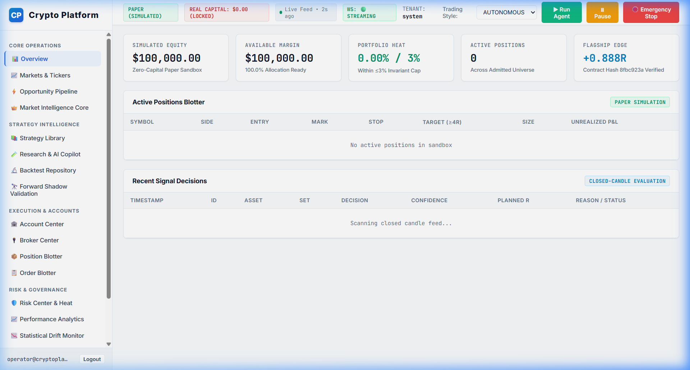
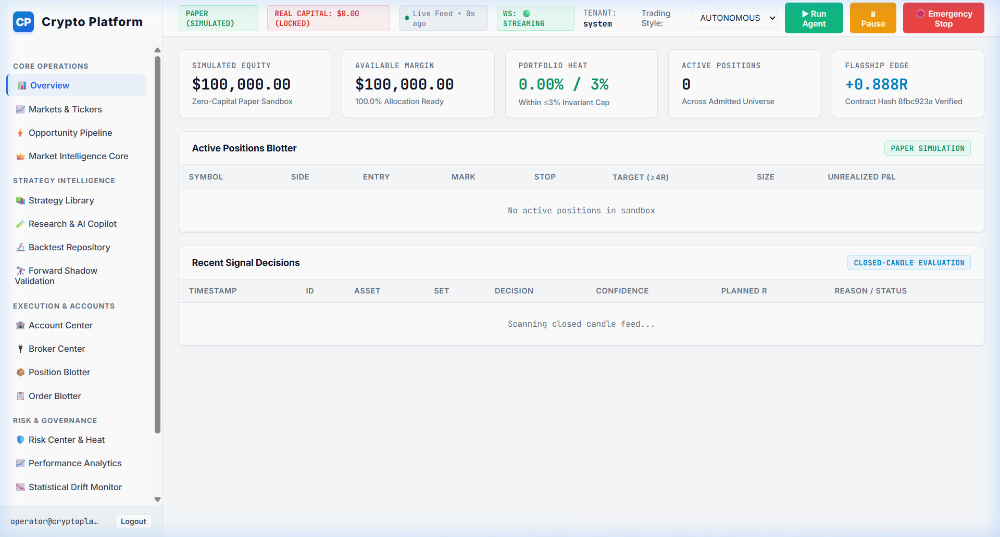
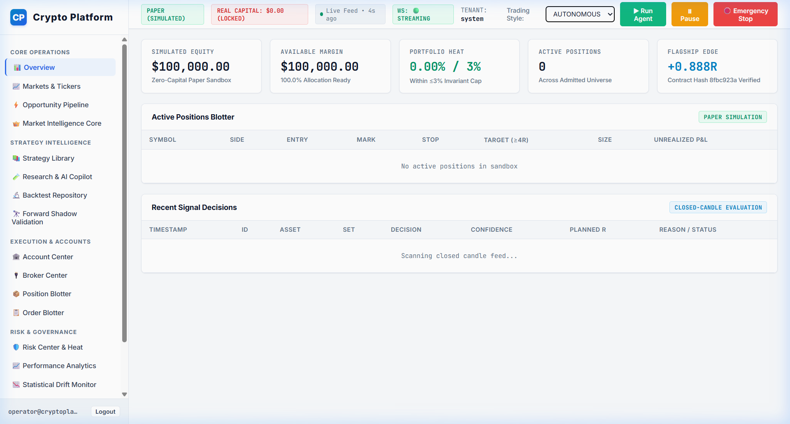
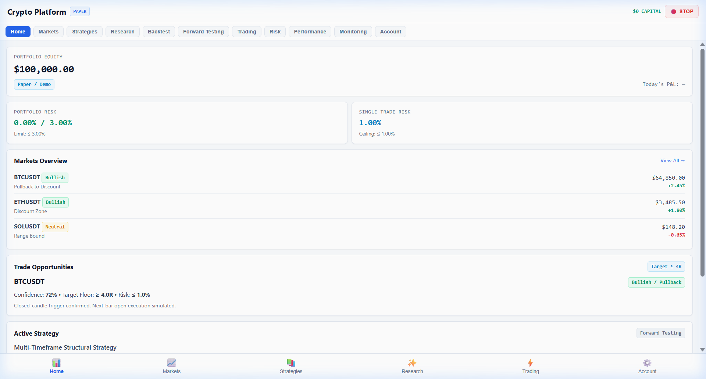
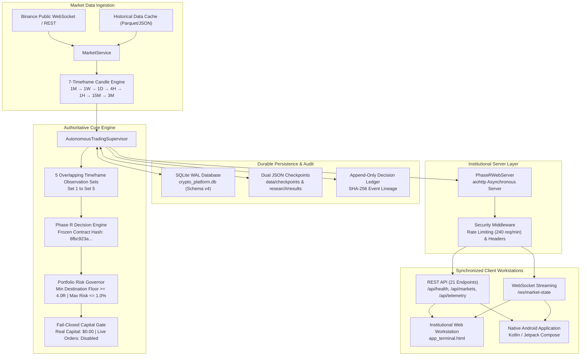
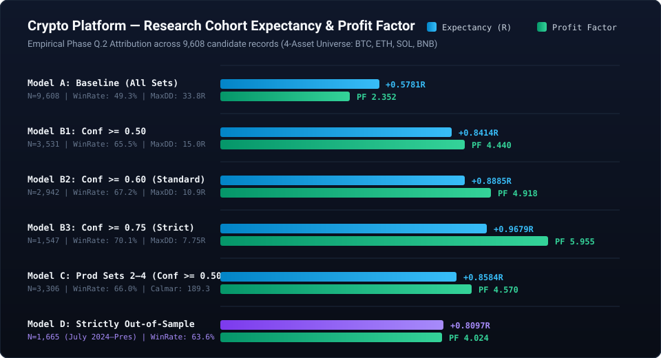
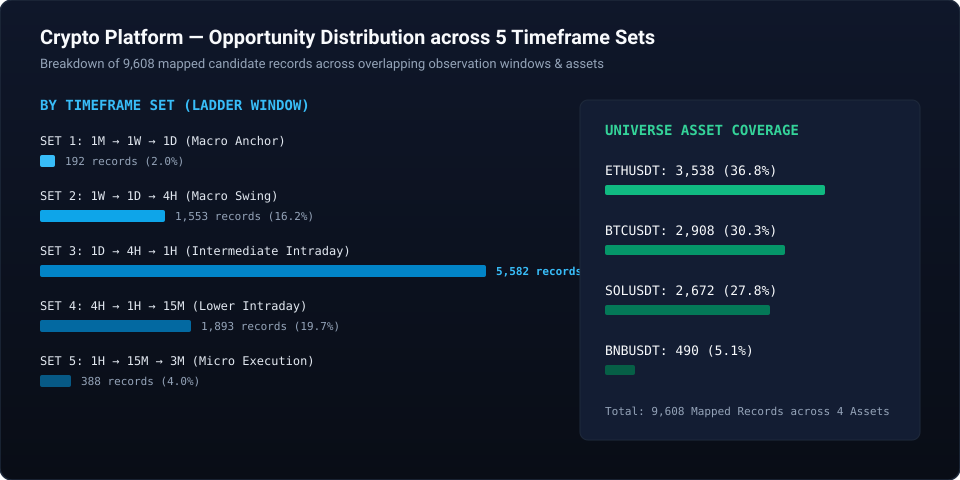
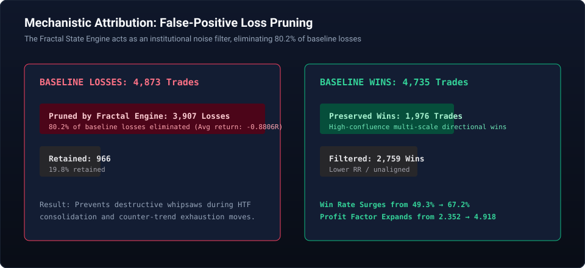

# Crypto Platform

## Autonomous Systematic Digital Asset Trading, Research & Operations Platform

> **"We do not predict price; we model market state across scales, form conditional expectations from that state, wait for price to confirm or invalidate those expectations, and execute only when the multi-timeframe state provides a valid opportunity."**

[](https://github.com/Quantitative-Systems/crypto-platform/actions/workflows/crypto-platform-ci.yml)
[](https://github.com/Quantitative-Systems/crypto-platform/actions/workflows/android-build.yml)
[](#27-running-tests)
[-blue)](#12-strategy-and-research-lifecycle)
[-red)](#15-risk-management-and-capital-safety)
[](LICENSE)

---

## Table of Contents

01. [Project Title & Introduction](#01-project-title--introduction)  
02. [Key Project Characteristics](#02-key-project-characteristics)  
03. [Project Status & Important Limitations](#03-project-status--important-limitations)  
04. [Visual Preview](#04-visual-preview)  
05. [Problem the Platform Addresses](#05-problem-the-platform-addresses)  
06. [Product Overview](#06-product-overview)  
07. [Core Architecture](#07-core-architecture)  
08. [End-to-End Data Flow](#08-end-to-end-data-flow)  
09. [Market-State Model](#09-market-state-model)  
10. [Seven-Timeframe Ladder](#10-seven-timeframe-ladder)  
11. [Five Overlapping Timeframe Sets](#11-five-overlapping-timeframe-sets)  
12. [Strategy & Research Lifecycle](#12-strategy-and-research-lifecycle)  
13. [Historical Research Methodology](#13-historical-research-methodology)  
14. [Backtesting & Validation](#14-backtesting-and-validation)  
15. [Risk Management & Capital Safety](#15-risk-management-and-capital-safety)  
16. [Backend & REST/WebSocket API](#16-backend-and-api)  
17. [Institutional Web Workstation](#17-web-workstation)  
18. [Native Android Application](#18-native-android-application)  
19. [Persistence & Crash Recovery](#19-persistence-and-recovery)  
20. [Security Model & Secret Hygiene](#20-security-model)  
21. [Technology Stack](#21-technology-stack)  
22. [Repository Structure](#22-repository-structure)  
23. [Installation & Prerequisites](#23-installation-and-prerequisites)  
24. [Local Setup](#24-local-setup)  
25. [Configuration & Environment Variables](#25-configuration-and-environment-variables)  
26. [Running the Application](#26-running-the-application)  
27. [Running Tests](#27-running-tests)  
28. [Android Build Instructions](#28-android-build-instructions)  
29. [Docker & Deployment Instructions](#29-docker-and-deployment-instructions)  
30. [API & WebSocket Documentation](#30-api-and-websocket-documentation)  
31. [Research Results & Their Limitations](#31-research-results-and-their-limitations)  
32. [Known Limitations](#32-known-limitations)  
33. [Development Roadmap](#33-roadmap)  
34. [Troubleshooting Guide](#34-troubleshooting)  
35. [Contributing Guidelines](#35-contributing)  
36. [Security Vulnerability Reporting](#36-security-reporting)  
37. [License](#37-license)  
38. [Disclaimer](#38-disclaimer)  
39. [Documentation Index](#39-documentation-index)  

---

## 01. Project Title & Introduction

**Crypto Platform** is an institutional-grade, multi-scale systematic trading, quantitative research, and operations system for digital assets. 

The platform is designed around **one single, authoritative Python backend** that continuously models cryptocurrency market structures, enforces strict risk controls, manages trade candidate lifecycles, and serves identical state contracts to an **Institutional Web Workstation** and a **Native Android Application**.

### Quick Start (Local Launch in Under 2 Minutes)

```bash
# 1. Clone the repository
git clone https://github.com/Quantitative-Systems/crypto-platform.git
cd crypto-platform

# 2. Set up virtual environment and install dependencies
python -m venv .venv
source .venv/bin/activate  # On Windows: .venv\Scripts\activate
pip install -r requirements.txt

# 3. Verify the frozen quantitative research contract
python cli.py verify-contract

# 4. Launch the platform in PAPER simulation mode
python cli.py start --mode PAPER --port 8080
```
Open your browser to `http://localhost:8080/dashboard` to access the live workstation.

---

## 02. Key Project Characteristics

- **Scale-Invariant Market Model:** Replaces isolated indicator calculations with a unified structural model separating **HOW** price moves (market structure), **WHERE** interactions occur (key zones), and **WHAT** phase stage is occurring (pullback vs continuation).
- **Continuous 7-Timeframe Ladder:** Synthesizes price action from `1M → 1W → 1D → 4H → 1H → 15M → 3M` in real time without future bar leakage.
- **5 Overlapping Observation Windows:** Eliminates single-timeframe myopia by monitoring 5 overlapping three-timeframe sets over one shared ladder.
- **Immutable Research Governance:** Alpha models and risk boundaries are sealed under an immutable SHA-256 contract digest (`8fbc923a...`).
- **Fail-Closed Capital Barrier:** Real capital authorized is pinned to **`$0.00`**; live exchange order submission is hard-locked.
- **Dual-Client Shared Parity:** Both the Web Workstation and native Android client consume identical authoritative REST APIs and WebSocket streams.

---

## 03. Project Status & Important Limitations

To maintain absolute scientific transparency, platform capabilities are classified into explicit operational statuses:

| Subsystem / Capability | Operational Status | Reality & Verification Evidence |
| :--- | :--- | :--- |
| **Python Core Engine** | **Implemented & Tested** | 300/300 tests pass; 9,608/9,608 tick invariant replay confirmed in CI. |
| **Market Model & Ladder** | **Implemented & Tested** | 7-timeframe engine (`1M` down to `3M`) running causally across 4 assets. |
| **Risk Governor & Gates** | **Implemented & Tested** | Real capital pinned to `$0.00`; live order execution fail-closed. |
| **Institutional Web Workstation** | **Implemented & Tested** | Single-page trading terminal running on aiohttp with live WebSockets. |
| **Native Android Client** | **Implemented & Tested** | Kotlin / Jetpack Compose; builds Debug, Staging, and Release APKs in CI. |
| **Historical Research Baseline** | **Historically Researched** | 9,608 mapped candidate records across BTC, ETH, SOL, BNB (July 2020–Pres). |
| **Paper Simulation Mode** | **Implemented & Operational** | Full simulated order execution with fees (10 bps), slippage (4 bps), and trailing stops. |
| **Public Cloud Staging** | **Configured (Not Live)** | `render.yaml` blueprint configured; live cloud service not yet provisioned. |
| **Android Play Store Distribution**| **Incomplete (Debug-Signed)**| Release APK is minified via R8 but signed with debug key; requires production keystore. |
| **Live Exchange Execution** | **Intentionally Disabled** | Live capital access locked by policy and hardware contract. |

---

## 04. Visual Preview

### Institutional Web Workstation

The Web Workstation provides a financial-terminal interface for monitoring multi-scale market states, active paper orders, and telemetry.


*Figure 4.1: Crypto Platform Institutional Web Terminal (`/dashboard`) displaying active simulated equity, real capital locks ($0.00), real-time order blotters, and market state tickers.*

### Multi-Timeframe Fractal State & Market Inspector


*Figure 4.2: Interactive Market State View (`/fractal-state`) displaying the continuous 7-timeframe ladder and 5-set alignment matrix.*

### Research & Strategy Lab Copilot


*Figure 4.3: Strategy Lab Interface (`/strategy-lab`) demonstrating natural language specification parsing and candidate evaluation.*

### System Health & Telemetry Monitor


*Figure 4.4: Telemetry Monitor (`/system-health`) displaying SQLite WAL connection status, memory utilization, and drift metrics.*

### Native Android Mobile Interface


*Figure 4.5: Native Android client interface demonstrating shared market feeds, 5-set ladders, and runtime backend configurability.*

---

## 05. Problem the Platform Addresses

Traditional crypto trading systems suffer from three fundamental architectural flaws:

1. **Disconnected Execution Divergence:** Strategies developed in Python notebooks are rewritten in C++ or Go for execution, introducing unmodeled latency, discrepancies in indicator definitions, and severe implementation shortfall.
2. **Single-Timeframe Myopia:** Technical strategies optimized on arbitrary candlestick intervals (e.g., 1-hour or 15-minute) ignore macro structural trend and higher-timeframe liquidity pools, leading to high false-breakout rates.
3. **Fragile Client Telemetry:** User interfaces rely on local client state calculations or unauthenticated endpoints, creating divergent views of market risks.

**Crypto Platform resolves this** by keeping **100% of market state generation, risk validation, and execution logic in the authoritative Python engine**. Clients are purely stateless visual projection interfaces that consume immutable event streams.

---

## 06. Product Overview

Crypto Platform is organized into five tightly coupled functional planes:

1. **Market Data & Ingestion Fabric:** Connects to public cryptocurrency feeds, validates tick timestamps, and drives the 7-timeframe candle engine.
2. **Quantitative State Engine:** Evaluates swings, structure breaks (CHOCH/BOS), dealing range discounts, and phase state across 5 overlapping sets.
3. **Execution & Risk Governor:** Enforces destination targets ($\ge 4.0\text{R}$), caps risk ($\le 1.0\%$ per trade, $\le 3.0\%$ portfolio heat), and manages trailing stops.
4. **Persistence & Recovery Watchdog:** Stores state in SQLite WAL with idempotent transaction deduplication and dual-file JSON snapshots.
5. **Presentation Layer:** Serves 21 REST endpoints, WebSocket streaming, the web workstation, and Android mobile feeds.

---

## 07. Core Architecture

The end-to-end architecture is strictly unidirectional and causal:



See the full [System Architecture Specification](docs/architecture/SYSTEM_ARCHITECTURE.md) and [Architecture Diagrams Document](docs/assets/diagrams/ARCHITECTURE_DIAGRAMS.md).

---

## 08. End-to-End Data Flow

1. **Market Tick Arrival:** Inbound ticks from Binance are timestamp-verified against local UTC clocks.
2. **Multi-Scale Candle Synthesis:** The continuous candle engine aggregates ticks into closed bars across all 7 timeframes.
3. **State Generation:** When a bar closes on any timeframe, the `MarketStateGenerator` computes structural swings, Fair Value Gaps (FVGs), and order blocks.
4. **Set Alignment Check:** The 5 overlapping observation sets update their internal alignments (`HTF_MTF_ALIGNED`, `TRANSITIONAL`, etc.).
5. **Confidence Scoring:** Confluence is calculated ($0.00$ to $1.00$). Candidates with confidence $\ge 0.50$ pass to risk evaluation.
6. **Risk Validation:** The `PortfolioGovernor` validates the $\ge 4.0\text{R}$ reward-to-risk floor and tests whether portfolio heat allows new risk.
7. **Paper Execution & Ledger:** If valid, the position is entered in the paper ledger; the immutable event is committed to SQLite and broadcast via WebSockets.

---

## 09. Market-State Model

The platform enforces absolute separation between the **Canonical Market Model** (how price moves) and contextual setup filters:

```text
CANONICAL MARKET MODEL
├── HOW   = Market Structure & Trend (Swing Highs/Lows, CHOCH/MSS, BOS)
├── WHERE = Key Zones & Levels (Order Blocks, FVGs, Liquidity Pools, Discount > 50%)
└── WHAT  = Phase State (Primary: PULLBACK vs. CONTINUATION)
```

### Phase Classifications

- **`PULLBACK` (Primary Phase):** Counter-trend retrace into high-timeframe key zones.
- **`CONTINUATION` (Primary Phase):** Structural trend resumption following retrace completion.
- **`CONSOLIDATION` (Internal Transition):** Range-bound price action between defined boundaries; trading confidence is penalized.
- **`UNCERTAIN` (Fail-Closed Default):** Ambiguous or contradictory structure across scales; triggers an immediate `NO_TRADE` policy.

---

## 10. Seven-Timeframe Ladder

Price action flows across a continuous 7-timeframe ladder without gaps:

$$\text{1M (Monthly)} \longrightarrow \text{1W (Weekly)} \longrightarrow \text{1D (Daily)} \longrightarrow \text{4H} \longrightarrow \text{1H} \longrightarrow \text{15M} \longrightarrow \text{3M}$$

Every timeframe maintains identical state primitives, making structural detection scale-invariant.

---

## 11. Five Overlapping Timeframe Sets

To observe multi-horizon interaction without fragmenting market data into separate universes, the 7-timeframe ladder is partitioned into **5 overlapping observation sets**:

| Set Name | Timeframes (HTF → MTF → LTF) | Operational Horizon | Operational Role in Platform | Capital Status |
| :--- | :--- | :--- | :--- | :--- |
| **SET 1** | `1M → 1W → 1D` | Macro Context | Macro Regime Anchor & Major Destination Target | Zero Capital (Anchor) |
| **SET 2** | `1W → 1D → 4H` | Macro Swing | Multi-Week Trend Continuation & Key Zone Entries | Paper Eligible |
| **SET 3** | `1D → 4H → 1H` | Intermediate Intraday | Daily Trend & 4H Retracement Pullback Entries | Paper Eligible |
| **SET 4** | `4H → 1H → 15M` | Lower Scale Intraday | Session Structure & Tactical Entry Timing | Paper Eligible |
| **SET 5** | `1H → 15M → 3M` | Micro Execution | Microstructure Confirmation & Precision Triggers | Zero Capital (Filter) |

> **Critical Architecture Note:** These 5 sets are **overlapping observation windows over one single timeframe ladder**, not independent or disconnected trading universes.

---

## 12. Strategy & Research Lifecycle

Quantitative alpha exploration follows a disciplined, immutable progression:

```text
Hypothesis Formation
       ↓
Rule Formalization (Explicit Entry, Geometry & Invalidation Rules)
       ↓
Historical Replay (Causal Walk-Forward over 9,608 Candidates)
       ↓
Metric Validation (Target Floor >= 4.0R, Slippage & Fee Modeling)
       ↓
Out-of-Sample Verification (Strict Post-July 2024 Period)
       ↓
Paper / Shadow Execution (24/7 Live Data Simulation)
       ↓
Production Eligibility Review (Sets 2–4, Confidence >= 0.50)
       ↓
Monitoring & Drift Surveillance (Rolling Expectancy Tracking)
```

The research contract is frozen under SHA-256 seal:
```
8fbc923a104e7688c3a9f0e4b8592c30dfb0b9a67a84511d5e49f8721c432098
```
Verify the contract locally at any time:
```bash
python cli.py verify-contract
```

---

## 13. Historical Research Methodology

All historical evaluations operate under strict empirical safeguards:
- **Zero Future Leakage:** State calculations execute exclusively upon closed bars (`is_closed_candle = True`).
- **Causal Execution Modeling:** Entries execute on the next bar open (`NEXT_BAR_OPEN`).
- **Realistic Friction:** 10 bps taker fee, 4 bps slippage, and 1.5 bps spread modeled on every round-trip.
- **Intrabar Stop Collision:** In bars where high and low touch both stop-loss and take-profit, the stop is presumed to hit first (`ADVERSE_FIRST`).

---

## 14. Backtesting & Validation

### Reported Research Figures (Phase Q.2 Baseline)

The historical quantitative baseline was audited across a 4-asset universe (`BTCUSDT`, `ETHUSDT`, `SOLUSDT`, `BNBUSDT`) spanning July 2020 through October 2026.

> **Sample Count Precision:** The dataset contains **9,608 mapped candidate trade records** corresponding to **9,587 unique physical market events** (21 events mapped simultaneously across overlapping sets).


*Figure 14.1: Research cohort performance comparison across confidence thresholds and out-of-sample periods.*

| Evaluation Cohort | Trades ($N$) | Expectancy ($R$) | Profit Factor | Win Rate | Max Drawdown ($R$) | Status |
| :--- | :--- | :--- | :--- | :--- | :--- | :--- |
| **Model A: Unfiltered Baseline** | 9,608 | $+0.5781\text{R}$ | 2.352 | 49.27% | $33.81\text{R}$ | Historical Baseline |
| **Model B1: Confidence $\ge 0.50$**| 3,531 | $+0.8414\text{R}$ | 4.440 | 65.51% | $14.99\text{R}$ | Historical Research |
| **Model B2: Confidence $\ge 0.60$**| 2,942 | $+0.8885\text{R}$ | 4.918 | 67.17% | $10.89\text{R}$ | Historical Research |
| **Model B3: Confidence $\ge 0.75$**| 1,547 | $+0.9679\text{R}$ | 5.955 | 70.07% | $7.75\text{R}$ | Historical Research |
| **Model C: Production Sets 2–4** | 3,306 | $+0.8584\text{R}$ | 4.570 | 65.97% | $14.99\text{R}$ | Production Eligible Cohort |
| **Model D: Strictly Out-of-Sample**| 1,665 | $+0.8097\text{R}$ | 4.024 | 63.60% | $14.99\text{R}$ | July 2024–Pres Validation |

*Important Cohort Distinctions:*
- **Production Eligibility (Model C):** 3,306 trades (Sets 2–4 with confidence $\ge 0.50$).
- **All-Set Confidence $\ge 0.50$ (Model B1):** 3,531 trades across all 5 sets.
- **All-Set Confidence $\ge 0.60$ (Model B2):** 2,942 trades across all 5 sets.


*Figure 14.2: Distribution of 9,608 candidate records across the 5 observation sets and 4 core assets.*

### The False-Positive Pruning Mechanism

The primary scientific value of the multi-scale fractal model is not speculative trade generation, but **systematic noise and false-breakout filtering**:


*Figure 14.3: Forensic breakdown of loss elimination. The model pruned 80.18% (3,907 / 4,873) of baseline losses.*

---

## 15. Risk Management & Capital Safety

The platform incorporates hardware and software capital governance enforced at the root interpreter level:

- **Zero Live Capital Authorized:** Real capital allocation is permanently locked at `$0.00`.
- **Fail-Closed Gate:** Order submission adapters throw `RuntimeError` if an attempt is made to transmit real capital to external exchanges.
- **Minimum Reward-to-Risk Floor:** Trades must provide $\ge 4.0\text{R}$ mathematical destination target geometry. Artificial stop-tightening to inflate $\text{R}$-multiples is disallowed.
- **Maximum Trade Risk:** $\le 1.0\%$ of equity per position.
- **Maximum Portfolio Heat:** $\le 3.0\%$ aggregate exposure.
- **Single-Asset Cap:** $\le 1.0\%$ cumulative base asset exposure.

---

## 16. Backend & API

The authoritative backend is built on Python 3.12 and `aiohttp`:
- **Port:** Configurable (defaults to `8080`).
- **REST Endpoints:** 21 production endpoints covering system health, telemetry, markets, 5-set ladders, strategy lab, broker accounts, and positions.
- **Streaming WebSockets:** Endpoint `/ws/market-state` broadcasts real-time multi-timeframe events and closed-candle updates.
- **Security Middleware:** Enforces rate limiting (240 requests/minute per IP) and institutional security headers (`Content-Security-Policy`, `X-Content-Type-Options: nosniff`, `X-Frame-Options: DENY`).

---

## 17. Web Workstation

The Web Workstation (`web/static/app_terminal.html`) is an institutional-grade financial terminal:
- **Responsive Layout:** Live ticker pills, asset selector, 7-timeframe status ladder, active position blotter, and decision ledger.
- **Dynamic Routing:** `getApiBase()` / `apiFetch()` routes all requests to the configured backend.
- **Runtime Backend Configurator:** Allows switching between local, staging, or custom backend endpoints on the fly.
- **Zero Mock Fallbacks:** Reports connection drops and server errors honestly without fabricating artificial ticks.

---

## 18. Native Android Application

The mobile client (`mobile/android/app`) is a native Kotlin application built with Jetpack Compose:
- **Package ID:** `io.cryptoplatform.app`
- **Flavors & Variants:**
  - `debug`: Points to local loopback emulator (`http://10.0.2.2:8080`).
  - `staging`: Configured for cloud staging (`https://crypto-platform-staging.onrender.com`).
  - `release`: Configured with R8 code shrinking and minification enabled.
- **Shared Parity:** Uses the identical domain models, 5-set ladder inspectors, and WebSocket contracts as the Web Workstation.

---

## 19. Persistence & Recovery

Data durability is guaranteed across process restarts:
- **SQLite Database (`data/db/crypto_platform.db`):** Operates under Write-Ahead Logging (`PRAGMA journal_mode=WAL`).
- **Atomic Migrations:** Versioned schema (`v1` through `v4`) with automated idempotent migrations.
- **Dual Checkpoints:** Snapshots saved in `data/checkpoints/` and `research/results/`.
- **Idempotency Guard:** Prevents duplicate order execution across restarts by verifying order transaction hashes.

---

## 20. Security Model

- **Zero Committed Secrets:** The repository is scanned in CI for API keys, passwords, and keystores.
- **Local Credentials:** Local development secrets are loaded via environment variables or `.env` files explicitly ignored by Git.
- **Isolated Network Security:** Android network security configuration enforces strict HTTPS for remote traffic while permitting cleartext solely for local development loopback (`10.0.2.2`).

---

## 21. Technology Stack

| Layer | Primary Technologies |
| :--- | :--- |
| **Backend Core** | Python 3.12, `aiohttp` 3.14+, `numpy` 2.5+, `pandas` 3.0+, `pydantic` 2.13+ |
| **Persistence** | SQLite 3 (WAL mode), Schema Migrations, Atomic JSON Snapshots |
| **Web Workstation** | HTML5, Modern CSS (Glassmorphism), Vanilla ES2022 JavaScript, WebSockets |
| **Android Client** | Kotlin 1.9+, Jetpack Compose, Material 3, OkHttp 4.12+, AndroidX Security Crypto |
| **Build & CI/CD** | Gradle 8.5+, Temurin JDK 17, GitHub Actions (`ubuntu-latest`), Docker Compose |
| **Testing** | `pytest` 9.1+, `pytest-asyncio`, JUnit 4 |

---

## 22. Repository Structure

```text
crypto-platform/
├── .github/workflows/          # CI/CD workflows (standard CI & Android builds)
├── accounts/                   # Multi-broker and paper account management
├── broker/                     # Exchange demo & paper venue integrations
├── cli.py                      # Unified operational command-line interface
├── core/                       # Auth, persistence, WAL database, migrations
│   ├── config/                 # Startup validator & environment gates
│   └── persistence/            # SQLite manager, migrations, recovery watchdog
├── data/                       # Local SQLite database and JSON checkpoints
├── docs/                       # Authoritative documentation library
│   ├── architecture/           # System, data, and mobile architecture specs
│   ├── assets/                 # Architecture diagrams, screenshots, research SVGs
│   ├── operations/             # Runbooks, staging, and hosting decisions
│   └── research/               # Methodology, reports, and charters
├── execution/                  # Autonomous supervisor, agent, risk governors, safety gate
├── instrument/                 # Universe manager and asset metadata
├── main.py                     # 24/7 autonomous production entrypoint
├── market_data/                # Binance client, 7-timeframe candle engine, cache
├── market_model/               # Canonical market model, 5-set definitions, observations
├── mobile/android/             # Native Android application (Kotlin / Jetpack Compose)
├── notifications/              # Operational alert router
├── research/                   # Frozen research contracts, datasets, experiments, reports
├── strategy/                   # Strategy family registry and natural language Strategy Lab
├── tests/                      # Unit, integration, and invariant regression suites
└── web/                        # Async web server, security middleware, and web terminal
```

---

## 23. Installation & Prerequisites

- **Python:** 3.12 or newer.
- **Operating System:** Linux, macOS, or Windows (PowerShell).
- **Git:** 2.30+.
- **Android Development (Optional):** Android Studio Hedgehog+ with JDK 17.

---

## 24. Local Setup

```bash
# 1. Clone the repository
git clone https://github.com/Quantitative-Systems/crypto-platform.git
cd crypto-platform

# 2. Create virtual environment
python -m venv .venv
source .venv/bin/activate  # On Windows: .venv\Scripts\activate

# 3. Install core dependencies
pip install -r requirements.txt

# 4. Initialize database schema
python cli.py db-migrate
```

---

## 25. Configuration & Environment Variables

Create a local `.env` file in the root directory (based on `.env.example`):

```bash
# Platform Operational Mode (PAPER | SHADOW | BROKER_DEMO)
PLATFORM_MODE=PAPER

# Web Server Configuration
SERVER_HOST=127.0.0.1
SERVER_PORT=8080

# Capital Safety (MUST REMAIN 0.00)
REAL_CAPITAL_AUTHORIZED_USD=0.00
LIVE_TRADING_ENABLED=false

# SQLite Database
DATABASE_PATH=data/db/crypto_platform.db
```

---

## 26. Running the Application

### Via Unified CLI

```bash
# Start paper simulation mode
python cli.py start --mode PAPER --port 8080

# Check platform health
python cli.py health

# Inspect registered accounts
python cli.py accounts

# Run state reconciliation audit
python cli.py reconcile
```

### Via Main Entrypoint

```bash
python main.py --mode PAPER --port 8080
```

---

## 27. Running Tests

```bash
# Run complete test suite (unit and integration)
pytest

# Run core unit tests
pytest tests/unit

# Run contract integrity test
python cli.py verify-contract
```

---

## 28. Android Build Instructions

```bash
# Navigate to Android directory
cd mobile/android

# Run unit tests
./gradlew test

# Assemble Debug APK (for local emulator development)
./gradlew assembleDebug

# Assemble Staging APK (points to cloud staging)
./gradlew assembleStaging

# Assemble Release APK (minified with R8)
./gradlew assembleRelease
```
APKs will be generated in `mobile/android/app/build/outputs/apk/`.

---

## 29. Docker & Deployment Instructions

```bash
# Build the production container
docker build -t crypto-platform:latest .

# Run container locally with persistent storage
docker run -d \
  -p 8080:8080 \
  -v $(pwd)/data:/app/data \
  -e PLATFORM_MODE=PAPER \
  --name crypto-platform-prod \
  crypto-platform:latest
```

---

## 30. API & WebSocket Documentation

### Core Endpoints

- `GET /health` or `GET /api/health`: System health status and capital safety validation.
- `GET /api/telemetry`: Real-time runtime metrics (uptime, memory, active positions).
- `GET /api/markets`: List admitted universe assets and current prices.
- `GET /api/markets/{symbol}/five-set-ladder`: Full 5-set observation ladder for symbol.
- `GET /api/positions`: Active paper positions and closed position ledger.
- `GET /api/orders`: Order blotter history with fill execution timestamps.
- `GET /api/reconciliation`: Real-time ledger and broker reconciliation report.
- `GET /ws/market-state`: Streaming WebSocket broadcasting live multi-scale market state updates.

---

## 31. Research Results & Their Limitations

- **Simulated Performance Disclaimer:** Historical expectancy (+0.8885R on confidence $\ge 0.60$) and win rates reflect backtested simulations across historical data and do not guarantee future performance.
- **Slippage & Extreme Volatility:** While 4 bps slippage and adverse collision policies are modeled, live cryptocurrency markets can exhibit liquidity gaps exceeding modeled tolerances.
- **Sample Representation:** Evaluations are based on high-liquidity assets (`BTC`, `ETH`, `SOL`, `BNB`); low-liquidity pairs may exhibit different structural behaviors.

---

## 32. Known Limitations

1. **Cloud Persistence Constraint:** Free-tier cloud providers (e.g. Render) offer ephemeral filesystems. 24/7 persistent storage requires external volume mounting or managed database connection.
2. **Cold Starts:** Unpaid cloud instances sleep after 15 minutes of inactivity, requiring 30–60 seconds for wake-up.
3. **Android Distribution Signing:** The release APK built in CI is minified but signed with the Android debug key for validation purposes; production distribution requires generating a private release key.

---

## 33. Roadmap

- [x] Phase 1: Canonical Market Model & 7-Timeframe continuous candle engine.
- [x] Phase 2: Overlapping 5-set architecture parity across backend, Web, and Android.
- [x] Phase 3: SQLite WAL persistence, atomic migrations, and restart recovery.
- [x] Phase 4: R8 ErrorProne release minification recovery and automated 3-variant APK builds.
- [ ] Phase 5: Managed PostgreSQL persistence integration for cloud staging.
- [ ] Phase 6: Automated Google Play Store deployment via fastlane and secure keystore secrets.
- [ ] Phase 7: Multi-signature hardware authorization module for micro-live capital unlock.

---

## 34. Troubleshooting

- **Port 8080 already in use:** Specify a custom port: `python cli.py start --port 8085`.
- **Database locked error:** Ensure WAL mode is active: run `python cli.py db-status`.
- **Android emulator connection failure:** Ensure you are using `http://10.0.2.2:8080` from within the Android emulator to access your local development machine.

---

## 35. Contributing

Contributions are welcomed from software engineers, quantitative researchers, and Android developers. Please read [CONTRIBUTING.md](docs/CONTRIBUTING.md) before submitting a Pull Request.

1. Fork the repository.
2. Create your feature branch (`git checkout -b feature/alpha-enhancement`).
3. Ensure all tests and invariant checks pass (`pytest && python cli.py verify-contract`).
4. Commit your changes with conventional commit syntax.
5. Submit a Pull Request.

---

## 36. Security Reporting

If you discover a security vulnerability or potential capital leak, please review [SECURITY.md](docs/security/SECURITY.md) and report it privately via email to `security@quantitativesystems.org`. Do not file public GitHub issues for security vulnerabilities.

---

## 37. License

Crypto Platform is released under the **MIT License**. See [LICENSE](LICENSE) for details.

---

## 38. Disclaimer

This software is for research and educational purposes. Cryptocurrency trading involves substantial financial risk. The developers assume no liability for trading losses incurred through the use of this software. Live trading is hard-disabled fail-closed by default.

---

## 39. Documentation Index

- **Architecture:** [System Architecture](docs/architecture/SYSTEM_ARCHITECTURE.md) | [Diagrams Reference](docs/assets/diagrams/ARCHITECTURE_DIAGRAMS.md) | [Android Architecture](docs/architecture/CRYPTO_PLATFORM_ANDROID_ARCHITECTURE.md) | [Data Architecture](docs/architecture/CRYPTO_PLATFORM_DATA_ARCHITECTURE.md)
- **Operations:** [Operations Runbook](docs/operations/OPERATIONS.md) | [Staging Environment Guide](docs/operations/STAGING_ENVIRONMENT.md) | [Android Release Runbook](docs/operations/ANDROID_RELEASE_RUNBOOK.md) | [CI/CD Runbook](docs/operations/CI_CD_RUNBOOK.md)
- **Research:** [Research Methodology](docs/research/RESEARCH_METHODOLOGY.md) | [Research Status](docs/research/RESEARCH_STATUS.md) | [Phase Q.2 Audit Report](research/reports/PHASE_Q2_INCREMENTAL_VALUE_AND_SHADOW_VALIDATION.md)
- **Releases:** [Release Notes](docs/releases/RELEASE_NOTES.md) | [Changelog](docs/CHANGELOG.md)
