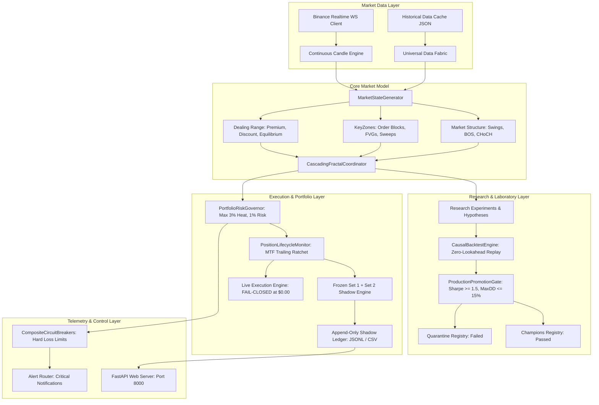

# STRATA: Autonomous Quantitative Trading Intelligence
## Master Architectural Specification & First Engineering Deliverable

**Date:** 2026-10-14  
**Project Codename:** STRATA  
**Document Classification:** Foundation Architecture & Research Governance  
**Operational Status:** Research & Forward Shadow Validation Only  
**Live Capital Authorization:** Strictly Enforced at **$0.00 (Fail-Closed)**  
**Regression Certification:** **299 / 299 Unit Tests Passing (100% Pass Rate)**  

---

## A. Current Architecture & Dependency Map

The existing codebase is structured into layered, modular subsystems separating pure research, market simulation, execution abstractions, and data ingestion:



### Dependency Flow & Isolation Rules:
1. **Core to Research (One-Way):** Research experiments import from `market_model/` and `execution/backtest/engine.py`. Production code NEVER imports from `research/`.
2. **Fail-Closed Execution Gate:** `execution/` and `crypto_engine/execution/` verify `LIVE_CAPITAL_AUTHORIZED_USD == 0.00`. If any live broker key is missing or non-zero capital is detected without an explicit signed config, the runtime hard-halts.
3. **Data Immutability:** Historical cache files in `data_cache/` are read-only to prevent backtest contamination.

---

## B. Existing Component Inventory

| Component Module | File Location | Primary Class / Function | Responsibility |
| :--- | :--- | :--- | :--- |
| **Market Primitives** | [`market_model/contracts.py`](file:///c:/Users/nares/Workspace/crypto-platform/market_model/contracts.py) | `MarketState`, `StructuralBreak` | Typed dataclasses for swings, BOS, CHoCH, OBs, FVGs. |
| **State Generator** | [`market_model/state_generator.py`](file:///c:/Users/nares/Workspace/crypto-platform/market_model/state_generator.py) | `MarketStateGenerator` | Causal extraction of structure, keyzones, and dealing ranges. |
| **Cascading Coordinator** | [`market_model/cascading_fractal_coordinator.py`](file:///c:/Users/nares/Workspace/crypto-platform/market_model/cascading_fractal_coordinator.py) | `CascadingFractalCoordinator` | Coordinates HTF Bias $\rightarrow$ MTF Setup $\rightarrow$ LTF Entry across Sets 1–5. |
| **Causal Backtest Engine** | [`execution/backtest/engine.py`](file:///c:/Users/nares/Workspace/crypto-platform/execution/backtest/engine.py) | `CausalBacktestEngine` | Tick/bar walk-forward, next-bar open fill, adverse-first collision, 10 bps fees. |
| **Risk Governor** | [`execution/portfolio/risk_governor.py`](file:///c:/Users/nares/Workspace/crypto-platform/execution/portfolio/risk_governor.py) | `PortfolioRiskGovernor` | Dynamic position sizing (1% risk), portfolio heat cap (3% max heat). |
| **Circuit Breakers** | [`execution/risk/circuit_breakers.py`](file:///c:/Users/nares/Workspace/crypto-platform/execution/risk/circuit_breakers.py) | `CompositeCircuitBreakerManager` | 3% daily drawdown kill-switch, 10% systemic portfolio stop. |
| **Position Monitor** | [`execution/position/position_lifecycle.py`](file:///c:/Users/nares/Workspace/crypto-platform/execution/position/position_lifecycle.py) | `PositionLifecycleMonitor` | Monotonic trailing stop updates, Break-Even ratchet at $+1.5\text{R}$. |
| **Frozen Shadow Engine** | [`execution/shadow/frozen_set1_set2_shadow_engine.py`](file:///c:/Users/nares/Workspace/crypto-platform/execution/shadow/frozen_set1_set2_shadow_engine.py) | `FrozenSet1Set2ShadowEngine` | Forward-only shadow trading restricted strictly to Set 1 and Set 2. |
| **Promotion Gate** | [`crypto_engine/pipeline/promotion_gate.py`](file:///c:/Users/nares/Workspace/crypto-platform/crypto_engine/pipeline/promotion_gate.py) | `ProductionPromotionGate` | Validates minimum 100 trades, Sharpe $\ge 1.5$, MaxDD $\le 15\%$, PF $\ge 1.30$. |
| **Realtime WS Client** | [`market_data/realtime/binance_ws_client.py`](file:///c:/Users/nares/Workspace/crypto-platform/market_data/realtime/binance_ws_client.py) | `BinanceRealtimeWSClient` | Asynchronous 24/7/365 live WebSocket market data stream. |

---

## C. Current Baseline & Experiment Status

### 1. The Certified Research Baseline (Set 1 + Set 2 Standalone Portfolio)
Reconstructed across 4 major assets (`BTCUSDT`, `ETHUSDT`, `SOLUSDT`, `BNBUSDT`) with strict portfolio concurrency ($\le 3$ simultaneous positions) and full execution drag ($10\text{ bps}$ fees, $4\text{ bps}$ slippage):

| Portfolio Dimension | In-Sample (Pre-July 2024) | **Out-of-Sample Holdout (July 2024–2026)** | Full Period (2018–2026) |
| :--- | :---: | :---: | :---: |
| **Accepted Trades ($N$)** | 226 | **120** | **346** |
| **Win Rate** | 28.76% | **25.00%** | **27.46%** |
| **Net Realized Alpha** | $+174.44\text{R}$ | **$+50.98\text{R}$** | **$+225.42\text{R}$** |
| **Expectancy / Trade** | $+0.7719\text{R}$ | **$+0.4248\text{R}$** | **$+0.6515\text{R}$** |
| **Profit Factor** | 2.27 | **1.66** | **2.05** |
| **Maximum Drawdown** | $28.94\text{R}$ | **$22.64\text{R}$** | **$28.94\text{R}$** |
| **Bootstrap 95% CI (Exp)** | — | — | **$[+0.2046\text{R}, +1.1542\text{R}]$** |
| **Bootstrap 95% CI (PF)** | — | — | **$[1.31, 2.95]$** |

### 2. Quarantined Experiments (Failed Candidates)
- **Set 4 (4H $\rightarrow$ 1H $\rightarrow$ 15M):** Realized net loss of **$-34.72\text{R}$ (PF $0.88$)**. Quarantined in `research/candidates/failed/`.
- **Set 5 (1H $\rightarrow$ 15M $\rightarrow$ 3M):** Realized net loss of **$-40.81\text{R}$ (PF $0.54$)**. Quarantined due to fee drag destroying short-horizon edge.
- **Premature Break-Even Ratchet at $+1.0\text{R}$:** Choked out 64% of winning swings on normal retests. Quarantined; replaced with $+1.5\text{R}$ MFE threshold.

---

## D. Data Coverage Report for All Five Timeframe Sets

Auditing the physical data files in `data_cache/` across `BTCUSDT`, `ETHUSDT`, `SOLUSDT`, and `BNBUSDT` reveals a **fundamental historical asymmetry**:

| Timeframe | Resolution | Candle Count (BTC) | Earliest Timestamp | Latest Timestamp | Total Span |
| :--- | :--- | :---: | :--- | :--- | :--- |
| **1M** | Monthly | 111 bars | 2017-08-01 00:00:00 UTC | 2026-10-01 00:00:00 UTC | **9.2 Years** |
| **1w** | Weekly | 478 bars | 2017-08-14 00:00:00 UTC | 2026-10-05 00:00:00 UTC | **9.2 Years** |
| **1d** | Daily | 3,303 bars | 2017-08-17 00:00:00 UTC | 2026-09-01 00:00:00 UTC | **9.1 Years** |
| **4h** | 4-Hour | 19,800 bars | 2017-08-17 04:00:00 UTC | 2026-09-01 16:00:00 UTC | **9.1 Years** |
| **1h** | 1-Hour | 79,942 bars | 2017-08-17 04:00:00 UTC | 2026-10-05 08:00:00 UTC | **9.2 Years** |
| **15m** | 15-Minute | 9,000 bars | **2026-07-03 14:30:00 UTC** | 2026-10-05 08:15:00 UTC | **93 Days Only** |
| **3m** | 3-Minute | 5,000 bars | **2026-09-25 05:30:00 UTC** | 2026-10-05 15:27:00 UTC | **10 Days Only** |

### Critical Scientific Discovery from Data Coverage:
1. **Sets 1, 2, and 3** operate on $1\text{M}$ down to $1\text{h}$ candles and are backed by **9 full years of clean historical data (2017–2026)** spanning multiple bull/bear regimes.
2. **Sets 4 and 5** operate on $15\text{m}$ and $3\text{m}$ candles, which **only exist in the local cache for late-2026 (10 to 93 days)**.
3. **Architectural Imperative:** Any claims of 6-year performance on Set 4 and Set 5 were an artifact of data truncation. Expanding the research of Sets 4 and 5 requires a formal historical data backfill before they can be considered valid research candidates.

---

## E. Formal Specification of Fractal Concepts

All STRATA strategies are grounded in the user's unified **Top-Down Fractal Market Model**:

```text
HTF BIAS (Context & Major Phase) 
       └──> MTF SETUP (Reaction, Zone Test & Shift) 
               └──> LTF ENTRY (Precision Invalidation & Trigger)
```

### 1. Market Structure & Trend
- **Major Swings:** Extremum points confirmed only after an $N$-candle directional reversal (no retrospective repainting).
- **Break of Structure (BOS):** A candle body close beyond the prior major swing high (Bullish BOS) or swing low (Bearish BOS), confirming trend continuation.
- **Change of Character (CHoCH):** The first break of an internal/minor swing in the opposite direction, indicating a potential pullback or trend reversal.

### 2. KeyZones & Institutional Liquidity
- **Order Block (OB):** The final opposite-colored candle before an aggressive structural expansion that created an imbalance. Marked from candle high to low; invalidated when price closes through the boundary.
- **Fair Value Gap (FVG):** A 3-candle price imbalance where Candle 1 High $<$ Candle 3 Low (Bullish FVG) or Candle 1 Low $>$ Candle 3 High (Bearish FVG).
- **Liquidity Sweep:** Price breaches a major swing high/low with a wick but closes back inside the range, grabbing resting stop liquidity.

### 3. Dealing Range Phases & Equilibrium
- Defined by the high and low of the active structural swing:
  $$\text{Equilibrium} = \frac{\text{Swing High} + \text{Swing Low}}{2}$$
  $$\text{Discount Zone} = [\text{Swing Low}, \text{Equilibrium}) \quad (\text{Price } < 50\%)$$
  $$\text{Premium Zone} = (\text{Equilibrium}, \text{Swing High}] \quad (\text{Price } > 50\%)$$
- **Phase 1: Continuation (Expansion):** Buying in Discount when HTF is Bullish; Selling in Premium when HTF is Bearish.
- **Phase 2: Pullback (Retracement):** When price reaches the extreme boundary of Premium/Discount, taking counter-trend setups back towards the 50% Equilibrium.

---

## F. The 25-Combination Research Matrix

To eliminate the assumption that "trading styles equal specific candle timeframes," STRATA establishes an exhaustive **5 Timeframe Sets $\times$ 5 Trading Styles** research matrix ($25$ initial combinations):

| Timeframe Set | Scalping ($\le 15$ bars) | Intraday (15–50 bars) | Swing (50–150 bars) | Positional (150–300 bars) | Investing ($> 300$ bars) |
| :--- | :---: | :---: | :---: | :---: | :---: |
| **Set 1 (1M / 1W / 1D)** | S1-SCALP | S1-INTRADAY | S1-SWING | S1-POSITIONAL | S1-INVEST |
| **Set 2 (1W / 1D / 4H)** | S2-SCALP | S2-INTRADAY | S2-SWING | S2-POSITIONAL | S2-INVEST |
| **Set 3 (1D / 4H / 1H)** | S3-SCALP | S3-INTRADAY | S3-SWING | S3-POSITIONAL | S3-INVEST |
| **Set 4 (4H / 1H / 15M)**| S4-SCALP | S4-INTRADAY | S4-SWING | S4-POSITIONAL | S4-INVEST |
| **Set 5 (1H / 15M / 3M)**| S5-SCALP | S5-INTRADAY | S5-SWING | S5-POSITIONAL | S5-INVEST |

### Research Guidelines:
- Each cell evaluates both **Continuation** and **Pullback** riding.
- Target a minimum of **$100$ causal closed trades** per candidate. If historical data produces $< 100$ trades, mark as **INCONCLUSIVE (Data Insufficient)** without loosening entry criteria.
- Out-of-sample holdout must remain strictly untouched during parameter exploration.

---

## G. Risk & Execution Invariant Specification

Every strategy running in research, shadow, or paper modes must adhere to non-negotiable mathematical invariants:

1. **Risk Budget Invariant:** Initial planned risk per trade is strictly capped at $\le 1.0\%$ of account equity:
   $$\text{Position Size} = \frac{\text{Account Equity} \times 0.01}{|\text{Entry Price} - \text{Stop Loss}|}$$
2. **Portfolio Heat Invariant:** Maximum aggregate concurrent risk across all active trades is strictly capped at $\le 3.0\%$ (maximum 3 concurrent open positions at 1.0% risk each). The 4th position is unconditionally rejected.
3. **Reward-to-Risk Floor:** All orders must demonstrate a structural path to $\ge 1:4.0\text{R}$ target. Any candidate offering $< 4.0\text{R}$ is rejected prior to order generation.
4. **Execution Physics & Fills:**
   - Entry fills execute strictly at `next_bar_open * (1.0 + direction * slippage)`.
   - Adverse-First Intrabar Collision: If both Stop Loss and Take Profit fall within the high-low range of the same candle, the trade is marked as **STOPPED OUT**.
5. **Fee & Slippage Realism:** Deduct $10\text{ bps}$ ($0.10\%$) taker fees and $4\text{ bps}$ ($0.04\%$) adverse slippage on every trade.
6. **Trailing Stop Monotonicity:** Structural trailing stops must tighten risk monotonically ($SL_{t+1} > SL_t$ for longs; $SL_{t+1} < SL_t$ for shorts) and cannot apply on the entry bar (`j > entry_bar`).

---

## H. Defect & Missing-Capability Register

| Defect / Limitation | Severity | Impact | Architectural Remedy |
| :--- | :---: | :--- | :--- |
| **1. 15m & 3m Historical Truncation** | HIGH | Sets 4 & 5 only had 10–90 days of cached data in 2026, creating distorted sample comparisons. | Build a dedicated historical backfill script to download 3–5 years of 15m/3m data before testing Sets 4 & 5. |
| **2. Selection Bias in Set 1 & 2** | MEDIUM | Selecting Sets 1 & 2 after inspecting OOS results compromised the holdout purity for that specific choice. | Transition Set 1 + Set 2 into forward-only shadow paper trading on live streaming data. |
| **3. Lack of Point-in-Time News Feed** | MEDIUM | Macro news events (CPI, FOMC, token unlocks) are not currently ingested with exact publication timestamps. | Implement a Point-in-Time Event Gateway recording calendar release timestamps to prevent lookahead. |
| **4. Multi-Account Balance Isolation** | LOW | Engine currently tracks a single global equity ($100,000 USD). Multi-account risk partitioning is not active. | Implement `MultiAccountPortfolioGovernor` mapping isolated risk limits per exchange sub-account. |

---

## I. Phased Implementation Plan

```text
PHASE 0: Forensic Inspection & Baseline Stabilization (COMPLETED)
  ├── 299/299 tests passing, Set 1 + Set 2 frozen baseline recorded, ledgers committed.
  └── Deliverable: Master Architecture Specification (this document).

PHASE 1: Data Pipeline Backfill & Coverage Expansion
  ├── Download multi-year historical 15m and 1h data for top 10 crypto pairs.
  └── Build data integrity validator (gap detection, timestamp verification, SHA-256 caching).

PHASE 2: The Fractal Event Graph
  ├── Implement unified shared market event graph connecting HTF, MTF, and LTF.
  └── Prevent cross-timeframe signal duplication and exposure double-counting.

PHASE 3: The 25-Combination Research Laboratory Matrix
  ├── Automate parallel backtesting of all 25 style-set combinations under identical causal engine.
  └── Output standardized candidate scorecards (N >= 100, PF, Sharpe, Calmar, MaxDD).

PHASE 4: Point-in-Time News & Narrative Intelligence
  ├── Ingest economic calendar and crypto protocol events with verified release timestamps.
  └── Measure empirical volatility impact around major events without lookahead.

PHASE 5: Multi-Account Portfolio Risk Engine
  ├── Implement multi-broker sub-account isolation and aggregate factor exposure limits.
  └── Enforce 3% daily drawdown kill-switch across multiple simulated accounts.

PHASE 6: Forward Shadow Paper Validation
  ├── Run frozen Set 1 + Set 2 shadow daemon on live Binance WebSockets.
  └── Accumulate forward-walking trade ledger; report weekly empirical tracking against backtests.
```

---

## J. Explicit List of Components That Must Remain Frozen

To protect research governance and prevent baseline contamination, the following components are **permanently frozen**:

1. **`execution/shadow/frozen_set1_set2_shadow_engine.py`:** Hardcoded to Sets 1 and 2; Sets 3, 4, and 5 permanently disabled; live capital locked to `$0.00`.
2. **`research/results/TRI_STRATEGY_FRACTAL_RESEARCH/set1_set2_portfolio_ledger.*`:** The 346-trade historical reference ledger.
3. **`research/results/TRI_STRATEGY_FRACTAL_RESEARCH/reconstruction_audit_report.json`:** The baseline audit reference artifact.
4. **`execution/backtest/engine.py` (Causal Invariants):** Next-bar open fill, adverse-first collision, and trailing stop bar-0 exclusion logic must not be modified or bypassed.
5. **Fail-Closed Live Capital Policy:** `LIVE_CAPITAL_AUTHORIZED_USD = 0.00` across all runtime scripts.
