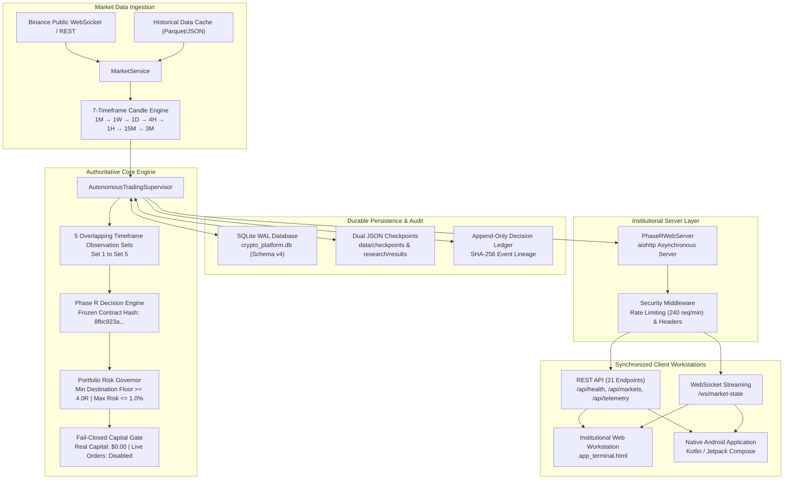
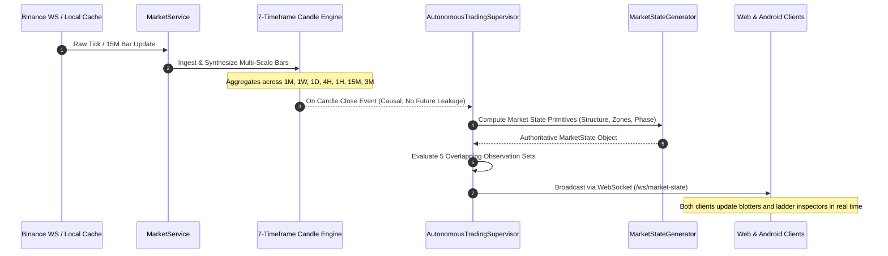
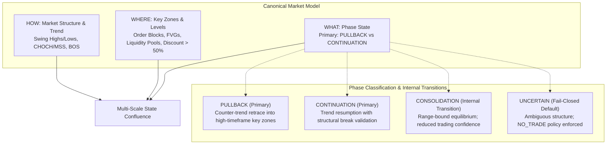
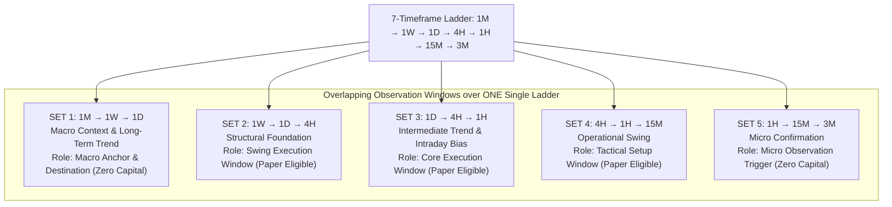
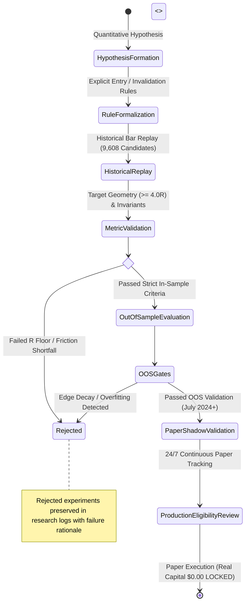
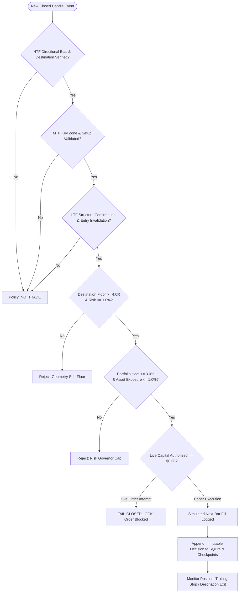

# Crypto Platform — Architecture Diagrams & Data Flows

This document contains the authoritative Mermaid diagrams representing the actual, verified subsystems and workflows of the **Crypto Platform**.

---

## 1. System Architecture



---

## 2. Market-Data Lifecycle



---

## 3. Market-State Model Hierarchy



---

## 4. Seven-Timeframe Continuous Ladder

```mermaid
graph LR
    M1["1M<br/>Macro Context"] --> W1["1W<br/>Macro Trend"]
    W1 --> D1["1D<br/>Structural Bias"]
    D1 --> H4["4H<br/>Intermediate Swing"]
    H4 --> H1["1H<br/>Tactical Setup"]
    H1 --> M15["15M<br/>Execution Trigger"]
    M15 --> M3["3M<br/>Micro Structure"]

    style M1 fill:#1e293b,stroke:#38bdf8,stroke-width:2px,color:#f8fafc
    style W1 fill:#1e293b,stroke:#38bdf8,stroke-width:2px,color:#f8fafc
    style D1 fill:#1e293b,stroke:#0ea5e9,stroke-width:2px,color:#f8fafc
    style H4 fill:#1e293b,stroke:#0284c7,stroke-width:2px,color:#f8fafc
    style H1 fill:#1e293b,stroke:#0369a1,stroke-width:2px,color:#f8fafc
    style M15 fill:#1e293b,stroke:#10b981,stroke-width:2px,color:#f8fafc
    style M3 fill:#1e293b,stroke:#10b981,stroke-width:2px,color:#f8fafc
```



---

## 5. Five Overlapping Timeframe Observation Sets



---

## 6. Research & Validation Lifecycle



---

## 7. Trade Lifecycle & Safety Controls



---

## 8. Deployment Topology & Environmental Boundaries

```mermaid
graph TD
    subgraph LocalEnv [Local Development & Testing (Fully Operational)]
        DevPython["Python 3.12 Authoritative Backend<br/>python main.py / cli.py"]
        DevWeb["Institutional Web Workstation<br/>http://localhost:8080/dashboard"]
        DevAndroid["Android Native Emulator / Debug APK<br/>Connected via 10.0.2.2:8080"]
        DevDB["Local SQLite WAL DB<br/>data/db/crypto_platform.db"]
    end

    subgraph CIEnv [GitHub Actions Standard CI (100% Green)]
        CIPython["Quantitative Core & Regression Suite<br/>300 Tests | 9,608 Invariant Replay"]
        CIAndroid["Android Build Pipeline (Temurin JDK 17)<br/>assembleDebug | assembleStaging | assembleRelease"]
        CIArtifacts["Artifact Uploads (14-day retention)<br/>Debug APK | Staging APK | Release APK"]
    end

    subgraph StagingConfig [Staging Configuration (Blueprint Ready)]
        RenderSpec["render.yaml Blueprint<br/>Configured for web service & worker"]
        StagingURL["https://crypto-platform-staging.onrender.com<br/>Target mapped in Web & Android code"]
        RenderNote["⚠️ Not Live Provisioned<br/>Requires user GitHub linking & account provision"]
    end

    LocalEnv -.->|Validated via| CIEnv
    CIEnv -.->|Prepares Artifacts for| StagingConfig
```
